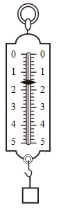
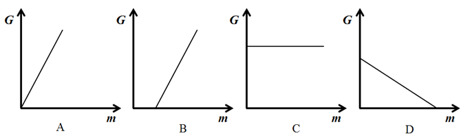

# Physics - 题目 1108

**ID**: ce76e04f1f14439188c46b4655859e56
**年级**: Grade 8
**难度**: Medium-Hard
**题型**: Experiment

## 题目
在探究“重力的大小跟什么因素有关”实验中，按如下步骤操作：(1)测量物体重力前，除了观察弹簧测力计（如图所示）的量程和外，还应将弹簧测力计在方向调零；(2)测量物体重力时，应将物体挂在弹簧测力计下并让它处于状态，这时弹簧测力计的示数即拉力大小就等于物体的重力。​​​​​​​‌而且发现细线被竖直拉直，这说明重力的方向是的；(3)实验小组的同学测量出了不同质量钩码所受重力的多组数据，如下表所示，当物体的质量为0.7kg时，它受到的重力是N；m/kg0.10.20.30.40.50.60.7G/N0.981.962.943.924.905.88(4)以下四个图象中，关于物体重力的大小与其质量的关系，正确的是。

## 解答

1. (1)[1][2]测量物体重力前，应先观察弹簧测力计的量程，被测物体重力不允许超过量程，为准确读数，还应观察弹簧测力计的分度值；由于重力是竖直向下的，所以应将弹簧测力计在竖直方向调零。
2. (2)[3]当物体静止时，物体受到的重力与弹簧测力计的拉力是一对平衡力，大小相等；所以，测量物体重力时，应将物体挂在弹簧测力计下并让它处于静止状态。
3. [4]重力的方向与拉力的方向相反，竖直向下，因此会发现细线被竖直拉直。
4. (3)[5]分析数据可得，重力与质量的比值
5. g= $\frac {G}{m}$ =9.8N/kg
6. 当物体的质量为0.7kg时，它受到的重力为
7. G=mg=0.7kg $\times $ 9.8N/kg=6.86N
8. 当物体的质量为0.7kg时，它受到的重力是6.86N。
9. (4)[6] $\frac {G}{m}$ =9.8N/kg，说明物体所受的重力跟它的质量成正比，图象为过坐标原点的直线，故选A。

## 知识点

**中文**:
  - 探究物重与物体质量的关系实验

**English**:
  - Experiment: Relationship between Weight and Mass

---
