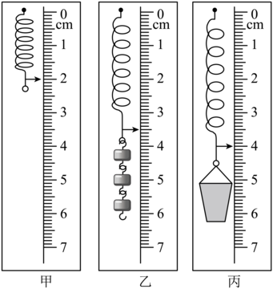

# Physics - 题目 2458

**ID**: d04557ee3fe1487b969ea463de5d7135
**年级**: Grade 8
**难度**: Medium-Hard
**题型**: Experiment

## 题目
小明用如图甲所示的装置来探究“弹簧的伸长量跟拉力的关系”。​​​​​​​‌弹簧的一端固定在木板上，他先在木板上标上0~7.00cm的刻度。把木板竖直放置，在弹簧下端挂钩码（每个钩码的质量为50g）。实验数据记录如下表：（g取 $10{\rm{N}}{\rm{/}}{\rm{k}}{\rm{g}}$ ）钩码个数012345678910弹簧长度/cm2.002.503.004.004.505.005.506.006.507.00弹簧的伸长量/cm00.501.002.002.503.003.504.004.505.00（1）当挂三个钩码时，指针所对应刻度如图乙，请在表中填写此时弹簧的长度和弹簧的伸长量；（2）分析表中弹簧的伸长量跟拉力的数据，你能得到的结论是：在弹性限度内，；（3）小明想用该装置设计一个直接测量液体密度的“密度秤”，他找来一个质量为100g的小桶，挂在弹簧下面的挂钩上，测量时，在桶中加满待测液体，根据指针指示的刻度，就能直接读出液体的密度：①该“密度秤”的零刻度线应在cm刻度线处；②在桶中加满水，指针指在4cm刻度线处，如图丙，则该小桶的容积是cm^{3}；③该“密度秤”能测量的最大的密度是g/cm^{3}；④小明想增大该“密度秤”的量程，在不更换弹簧的前提下，你的办法为：（写出一种即可）。

## 解答

1. （1）由图甲知，刻度尺的分度值为0.1cm，弹簧的原长度为2.00cm。图乙中，弹簧伸长后，长度为3.50cm，所以此时弹簧的伸长量 $Δl=3.5{{0}}{\rm{c}}{\rm{m}}{{-}}{{2}}{{.}}{{0}}{{0}}{\rm{c}}{\rm{m}}{\rm{=}}{{1}}{{.}}{{5}}{{0}}{\rm{c}}{\rm{m}}$ 。
2. （2）每个钩码的质量为50g，重力 $G=mg=0.05{\rm{k}}{\rm{g}}\times 10{\rm N}/{\rm kg}=0.5{\rm{N}}$ ，由表格数据知，由第1到第10次，弹簧所受的拉力分别为G、2G、3G、4G、5G、6G、7G、8G、9G、10G，每组对应的拉力与弹簧的伸长量的比值是定值，所以可得：在弹性限度内，弹簧的伸长量与拉力成正比。
3. （3）①小桶中，未倒入液体时，则所测液体的密度为0，小桶的重力 $G{{}_{桶}}=m{{}_{桶}}g=0.1{\rm{k}}{\rm{g}}\times 10{\rm{N}}{\rm{/}}{\rm{k}}{\rm{g}}=1{\rm{N}}=2G$ ，由表格数据知，此时弹簧的长度为3.00cm，所以“密度秤”的零刻度线在3cm刻度线处。
4. ②指针指在4cm刻度线处时，即弹簧的长度为4.00cm，由表格数据知，桶与水的总重力与4个钩码的重力相等，即 $G{{}_{总}}=4G=4\times 0.5{\rm{N}}{\rm{=}}{{2}}{\rm{N}}$ ，桶中水的重力 $G{{}_{水}}=G{{}_{总}}-G{{}_{桶}}=2{\rm{N}}{{-}}{{1}}{\rm{N}}{\rm{=}}{{1}}{\rm{N}}$ ，水的体积，即桶的容积 $V=\frac {m{{}_{水}}}{ρ{{}_{水}}}=\frac {\frac {G{{}_{水}}}{g}}{ρ{{}_{水}}}=\frac {\frac {1{\rm{N}}}{10{\rm{N}}{\rm{/}}{\rm{k}}{\rm{g}}}}{1{{.}}0\times 10{^{3}}{\rm{k}}{\rm{g}}{\rm{/}}{\rm{m}}{^{3}}}=10{^{-4}}{\rm{m}}{^{3}}=100{\rm{c}}{\rm{m}}{^{3}}$ 。
5. ③由图可知，弹簧的最大长度为7.00cm。由表格数据知，此时小桶及内装满的液体的最大总重力为10个钩码的重力，即 $G{{}_{大}}=10G=10\times 0.5{\rm{N}}{\rm{=}}{{5}}{\rm{N}}$ ，桶内所装液体的最大重力 $G{{}_{液}}=G{{}_{大}}-G{{}_{桶}}=5{\rm{N}}-{{1}}{\rm{N}}{\rm{=}}{{4}}{\rm{N}}$ ，液体的最大质量 $m{{}_{液}}=\frac {G{{}_{液}}}{g}=\frac {4{\rm{N}}}{10{\rm{N}}{\rm{/}}{\rm{k}}{\rm{g}}}=0.4{\rm{k}}{\rm{g}}={{4}}{{0}}{{0}}{\rm{g}}$ ，所测液体的最大密度 $ρ{{}_{液}}=\frac {m{{}_{液}}}{V}=\frac {400{\rm{g}}}{100{\rm{c}}{\rm{m}}{^{3}}}=4{\rm{g}}{\rm{/}}{\rm{c}}{\rm{m}}{^{3}}$ 。
6. ④不更换弹簧的前提，即弹簧伸长量最大值不变，则所挂钩码的最大重力不变，为了增大密度秤的量程，可减小桶的质量，从而增大所测液体的质量，小桶的容积不变时，根据 $ρ=\frac {m}{V}$ ，可增大密度秤的量程；或者小桶的质量不变，所测液体的质量不变，但减小小桶的容积；若最长7.00cm不是弹簧的最大长度，可在木板上增大刻度部分的长度。

## 知识点

**中文**:
  - 探究弹簧测力计原理的实验
  - 液体密度的测量实验

**English**:
  - Experiment: Principle of Spring Dynamometer
  - Experiment: Measuring Density of Liquids

---
