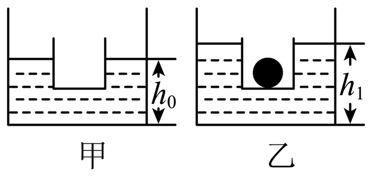

# Physics - 题目 1506

**ID**: d310e11511424885a5662a451a9d316d
**年级**: Grade 8
**难度**: Medium-Hard
**题型**: Experiment

## 题目
能否用身边的物品作为实验器材就能测量出物质的密度？学习了压强与浮力的知识后，小明产生了浓厚的探究兴趣。​​​​​​​‌请你帮他完成实验报告：〖实验目的〗测量金属球的密度〖实验器材〗柱形容器、烧杯、刻度尺、水（密度为ρ）〖实验过程〗（1）容器内注入适量的水，让烧杯漂浮在水面上，测出水的深度为h_{0}，图甲所示；（2）将金属球放入烧杯中，烧杯仍漂浮在水面上，测出水的深度为h_{1}，图乙所示；（3），测出（填写实验步骤及要测量的物理量）；〖实验结论〗金属球的密度表达式：。（用测量量和已知量表示）

## 解答

1. （3）[1][2]由图甲乙可知，设容器的底面积为S，当装有金属球的烧杯漂浮在盛有水的容器的水面上，排开水的体积增加量为
2. ΔV_{排}=S(h_{1}-h_{0})
3. 由物体的漂浮条件和F_{浮}=ρ_{液}V_{排}g可得
4. G_{球}=ΔF_{浮}=ρΔV_{排}g=ρS(h_{1}-h_{0})g
5. 由G=mg可知，金属球的质量为
6. $m{{}_{球}}=\frac {G{{}_{球}}}{g}=\frac {ρS\left ({h{{}_{1}}-h{{}_{0}}}\right )g}{g}=ρS\left ({h{{}_{1}}-h{{}_{0}}}\right )$
7. 此时要想得出实验结论，求出金属球的密度，根据 $ρ=\frac {m}{V}$ ，还需要测出金属球的体积，可用排水法测金属球的体积，故下一个实验步骤是将金属球放入水中，烧杯仍漂浮在水面上，测出水的深度为h_{2}。则金属球的体积为
8. V_{球}=S(h_{2}-h_{0})
9. [3]由上述分析可知，金属球的密度为
10. $ρ{{}_{球}}=\frac {m{{}_{球}}}{V{{}_{球}}}=\frac {ρS\left ({h{{}_{1}}-h{{}_{0}}}\right )}{S\left ({h{{}_{2}}-h{{}_{0}}}\right )}=\frac {ρ\left ({h{{}_{1}}-h{{}_{0}}}\right )}{h{{}_{2}}-h{{}_{0}}}$

## 知识点

**中文**:
  - 利用浮力知识测密度
  - 密度公式的应用
  - 物体的浮沉条件及其应用

**English**:
  - Measuring Density using Buoyancy
  - Application of Density Formula
  - Floating/Sinking Conditions and Applications

---
