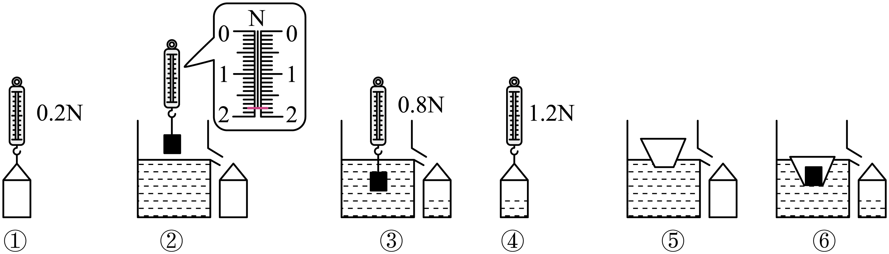

# Physics - 题目 602

**ID**: e60cf0544c934b77a2f11d97f430025f
**年级**: Grade 8
**难度**: Medium-Hard
**题型**: Experiment

## 题目
小吴同学对“阿基米德原理”进行了实验验证：（1）他首先对弹簧测力计沿竖直方向进行；（2）然后依次进行图①②的实验，其中图②中测力计示数为N，然后他将物块逐渐浸入水中至一定深度处，测力计示数先减小后保持不变，静止时如图③所示，对此正确的解释是：浸在水中的物体所受浮力的大小随着增大而增大。​​​​​​​‌接下来又进行了图④的实验，由图①②③④中数据可知：物块在水中所受浮力大小（大于/等于/小于）排开水的重力大小，初步验证了阿基米德原理的成立；（3）只将水换成盐水重复如图③④所示的实验，第③④次测力计的示数分别变为0.6N、1.4N，由此发现在盐水中阿基米德原理依然成立。他还发现：在物体排开液体体积相同时，越大，物体所受的浮力越大；物体在盐水中所受到的浮力大小为N；他所用盐水的密度为g/cm^{3}；（4）为了进一步验证结论是否具有普遍性，小吴同学用同一物块和图①中小桶，进行了如图⑤⑥所示的实验，若图⑥中小桶和桶中水的总重力等于N，表明：物体漂浮时阿基米德原理依然成立。

## 解答

1. （1）[1]由于要用弹簧测力计测量物体的重力和物体受到浮力，且物体的重力和浮力的方向都是在竖直方向上，由此可知，弹簧测力计应在竖直方向上调零。
2. （2）[2]由图②中的弹簧测力计可知，弹簧测量力计的分度值为0.1N，弹簧测力计的示数是1.8N。
3. [3]浸没前物体浸入水中的深度逐渐增大时，测力计的示数逐渐减小，其原因是物体浸入水中的体积逐渐增大，排开水的体积也逐渐增大，由此可得：浸在水中的物体受到的浮力的大小随物体排开水的体积的增大而增大。
4. [4]由②③可知物体受到的浮力大小为
5. $F{{}_{浮}}=G-F{{}_{拉}}={\rm{1}}{\rm{.}}{\rm{8}}{\rm{N}}{\rm{-}}{\rm{0}}{\rm{.}}{\rm{8}}{\rm{N}}{\rm{=}}{\rm{1}}{\rm{.}}{\rm{0}}{\rm{N}}$
6. 由①④可知物体排开水受到的重力为
7. $G{{}_{排}}=G{{}_{总}}一G{{}_{桶}}{\rm{=}}{\rm{1}}{\rm{.}}{\rm{2}}{\rm{N}}{\rm{-}}{\rm{0}}{\rm{.}}{\rm{2}}{\rm{N}}{\rm{=}}{\rm{1}}{\rm{.}}{\rm{0}}{\rm{N}}$
8. 由此可得：物体浸在水中受到的浮力大小等于物体排开水受到的重力。
9. （3）[5]由于盐水密度大于水的密度，物体浸没在盐水的受到的浮力为
10. $F{{}_{浮}}{^{\prime }}=G-F{{}_{拉}}{^{\prime }}={\rm{1}}{\rm{.}}{\rm{8}}{\rm{N}}{\rm{-}}{\rm{0}}{\rm{.}}{\rm{6}}{\rm{N}}{\rm{=}}{\rm{1}}{\rm{.}}{\rm{2}}{\rm{N}}$
11. 物体浸没在水中受到的浮力为
12. $F{{}_{浮}}=G-F{{}_{拉}}={\rm{1}}{\rm{.}}{\rm{8}}{\rm{N}}{\rm{-}}{\rm{0}}{\rm{.}}{\rm{8}}{\rm{N}}{\rm{=}}{\rm{1}}{\rm{.}}{\rm{0}}{\rm{N}}$
13. 由此可得：在物体排开液体的体积相同时，液体密度越大，物体受到的浮力越大。
14. [6][7]由将水换为盐水，重复③④所示的实验可知，物体浸没在盐水中受到的浮力为
15. $F{{}_{浮}}{^{\prime }}=G-F{{}_{拉}}{^{\prime }}={\rm{1}}{\rm{.}}{\rm{8}}{\rm{N}}{\rm{-}}{\rm{0}}{\rm{.}}{\rm{6}}{\rm{N}}{\rm{=}}{\rm{1}}{\rm{.}}{\rm{2}}{\rm{N}}$
16. 物体浸没在水中受到的浮力
17. $F{{}_{浮}}=G-F{{}_{拉}}={\rm{1}}{\rm{.}}{\rm{8}}{\rm{N}}{\rm{-}}{\rm{0}}{\rm{.}}{\rm{8}}{\rm{N}}{\rm{=}}{\rm{1}}{\rm{.}}{\rm{0}}{\rm{N}}$
18. 物体的体积为
19. $V{{}_{物}}=V{{}_{排水}}{\rm{=}}\frac {F{{}_{浮}}}{ρ{{}_{水}}g}=\frac {{\rm{1}}{\rm{.}}{\rm{0}}{\rm{N}}}{{\rm{1}}{\rm{.}}{\rm{0}}\times {\rm{1}}{\rm{0}}{^{{\rm{3}}}}{\rm{k}}{\rm{g}}{\rm{/}}{\rm{m}}{^{{\rm{3}}}}\times {\rm{1}}{\rm{0}}{\rm{N}}{\rm{/}}{\rm{k}}{\rm{g}}}{\rm{=}}{\rm{1}}{\rm{.}}{\rm{0}}\times {\rm{1}}{\rm{0}}{^{{\rm{-}}{\rm{4}}}}{\rm{m}}{^{{\rm{3}}}}$
20. 物体浸没在盐水中排开盐水的体积等于物体的体积，即
21. $V{{}_{排盐水}}=V{{}_{物}}={\rm{1}}{\rm{.}}{\rm{0}}\times {\rm{1}}{\rm{0}}{^{{\rm{-}}{\rm{4}}}}{\rm{m}}{^{{\rm{3}}}}$
22. 盐水的密度为
23. $ρ{{}_{盐水}}{\rm{=}}\frac {F{{}_{浮}}{^{\prime }}}{gV{{}_{盐水}}}=\frac {{\rm{1}}{\rm{.}}{\rm{2}}{\rm{N}}}{{\rm{1}}{\rm{0}}{\rm{N}}{\rm{/}}{\rm{k}}{\rm{g}}\times {\rm{1}}{\rm{.}}{\rm{0}}\times {\rm{1}}{\rm{0}}{^{{\rm{-}}{\rm{4}}}}{\rm{m}}{^{{\rm{3}}}}}{\rm{=}}{\rm{1}}{\rm{.}}{\rm{2}}\times {\rm{1}}{\rm{0}}{^{{\rm{3}}}}{\rm{k}}{\rm{g}}{\rm{/}}{\rm{m}}{^{{\rm{3}}}}={\rm{1}}{\rm{.}}{\rm{2}}{\rm{g}}{\rm{/}}{\rm{c}}{\rm{m}}{^{{\rm{3}}}}$
24. （4）[8]由图①可知小桶重0.2N，由图②可知物体重1.8N，图⑤中小容器漂浮，且此时没有水溢出；在小容器中放入物体后，小容器和物体漂浮；由漂浮条件可知，增加的重力等于增加的浮力，即 $\Delta {{}_{G}}=G{{}_{物}}=\Delta F{{}_{浮}}$ ；若物体漂浮时阿基米德原理依然成立，则 $\Delta F{{}_{浮}}=\Delta G{{}_{排}}=G{{}_{溢水}}$ ，由此可知 $G{{}_{溢水}}=G{{}_{物}}={\rm{1}}{\rm{.}}{\rm{8}}{\rm{N}}$ ；所以图⑥中小桶和桶中水的总重力为
25. $G{{}_{总}}=G{{}_{桶}}+G{{}_{溢水}}={\rm{0}}{\rm{.}}{\rm{2}}{\rm{N}}{\rm{+}}{\rm{1}}{\rm{.}}{\rm{8}}{\rm{N}}{\rm{=}}{\rm{2}}{\rm{.}}{\rm{0}}{\rm{N}}$

## 知识点

**中文**:
  - 实验探究阿基米德原理

**English**:
  - Experiment: Investigating Archimedes' Principle

---
