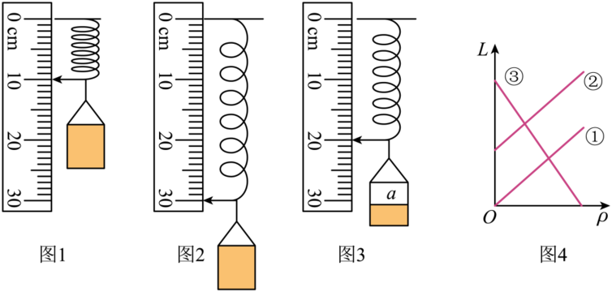

# Physics - 题目 1035

**ID**: ea138b690c454e7b9005061af33a9b76
**年级**: Grade 8
**难度**: Medium-Hard
**题型**: Experiment

## 题目
在综合实践活动中，小宇利用刻度尺、弹簧、细线、圆柱形薄壁小桶制成了液体密度秤。​​​​​​​‌弹簧未挂小桶在竖直放置时的长度为5cm，其受到的拉力每增大0.2N，长度就增加1cm。（本题中弹簧伸长均在弹性限度内，g=10N/kg，ρ_{水}=1×10^{3}kg/m^{3}）。（1）在弹簧下端挂上空桶时，指针位置如图1所示，小桶的重力为N；（2）在小桶内装满水时，指针位置如图2所示，则小桶的容积为cm^{3}；将小桶中的水缓缓抽出，当指针对准刻度为20cm时，在小桶上液面处标记为a（如图3所示）；此时小宇在刻度尺上20cm刻度线处标记了1.0g/cm^{3}；（3）将小桶中的水倒净，再装入另一未知液体到标记a处，此时指标对准22cm刻度处，则该未知液体的密度为g/cm^{3}；将桶中液体更换为不同密度的液体，重复上述实验；小宇对本实验原理进行了进一步分析，从而得到弹簧总长度L与被测液体的密度ρ之间的函数关系，则符合此关系的应是图4中的图线（选填“①”、“②”或“③”）；（4）图3所示密度秤的测量范围是g/cm^{3}，分度值是g/cm^{3}，仅利用题述所提供实验装置的条件下，要使该密度秤测出密度值更大的液体密度，可行的方法是。

## 解答

1. （1）由题意可知，弹簧受到的拉力每增大0.2N，长度增加1cm，弹簧未挂小桶在竖直放置时的长度为5cm，由图1可知，弹簧下端挂上小桶时，弹簧伸长的长度为 $10{\rm{c}}{\rm{m}}-5{\rm{c}}{\rm{m}}=5{\rm{c}}{\rm{m}}$ ，则小桶的重力为 $G=0.2{\rm{N}}{\rm{/}}{\rm{c}}{\rm{m}}\times 5{\rm{c}}{\rm{m}}=1{\rm{N}}$ 。
2. （2）由图2可知，小桶内装满水时，弹簧比图1中又伸长 $30{\rm{c}}{\rm{m}}-10{\rm{c}}{\rm{m}}=20{\rm{c}}{\rm{m}}$ ，因此可知小桶内水的重力为 $G{{}_{水}}=0.2{\rm{N}}{\rm{/}}{\rm{c}}{\rm{m}}\times 20{\rm{c}}{\rm{m}}=4{\rm{N}}$ ，小桶内装满水时，水的质量为 $m{{}_{水}}=\frac {G{{}_{水}}}{g}=\frac {{{4}}{\rm{N}}}{{{1}}{{0}}{\rm{N}}{\rm{/}}{\rm{k}}{\rm{g}}}=0.4{\rm{k}}{\rm{g}}=400{\rm{g}}$ ，小桶内水的体积为 $V{{}_{水}}=\frac {m{{}_{水}}}{ρ{{}_{水}}}=\frac {{{4}}{{0}}{{0}}{\rm{g}}}{{{1}}{{.}}{{0}}{\rm{g}}{\rm{/}}{\rm{c}}{\rm{m}}{^{{{3}}}}}=400{\rm{c}}{\rm{m}}{^{{{3}}}}$ ，因此小桶的容积为 $V{{}_{桶}}=V{{}_{水}}=40{{0}}{\rm{c}}{\rm{m}}{^{3}}$ 。
3. （3）将小桶中的水缓缓抽出，当指针对准刻度20cm时，弹簧比图1中伸长 $20{\rm{c}}{\rm{m}}-10{\rm{c}}{\rm{m}}=10{\rm{c}}{\rm{m}}$ ，小桶中水的重力为 $G{{}_{水}^{^{′}}}=0.2{\rm{N}}{\rm{/}}{\rm{c}}{\rm{m}}\times 10{\rm{c}}{\rm{m}}=2{\rm{N}}$ ，小桶中此时水的质量为 $m{{}_{水}^{^{′}}}=\frac {G{{}_{水}^{^{′}}}}{g}=\frac {{{2}}{\rm{N}}}{{{1}}{{0}}{\rm{N}}{\rm{/}}{\rm{k}}{\rm{g}}}=0.2{\rm{k}}{\rm{g}}=200{\rm{g}}$ ，小桶中此时水的体积为 $V{{}_{a}}=\frac {m{{}_{水}^{^{′}}}}{ρ{{}_{水}}}=\frac {{{2}}{{0}}{{0}}{\rm{g}}}{{{1}}{{.}}{{0}}{\rm{g}}{\rm{/}}{\rm{c}}{\rm{m}}{^{{{3}}}}}=200{\rm{c}}{\rm{m}}{^{3}}$ ，小桶中的水倒干净，再装入另一种未知液体到标记a处时，小桶中液体的体积为 $200{\rm{c}}{\rm{m}}{^{3}}$ ，此时指针对准22cm处，由此可知，小桶中液体的重力为 $G{{}_{液}}=0.2{\rm{N}}{\rm{/}}{\rm{c}}{\rm{m}}\times \left ({22{\rm{c}}{\rm{m}}-10{\rm{c}}{\rm{m}}}\right )=2.4{\rm{N}}$ ，液体的质量为 $m{{}_{液}}=\frac {G{{}_{液}}}{g}=\frac {{{2}}{{.}}{{4}}{\rm{N}}}{{{1}}{{0}}{\rm{N}}{\rm{/}}{\rm{k}}{\rm{g}}}=0.24{\rm{k}}{\rm{g}}=240{\rm{g}}$ ，液体的密度为 $ρ{{}_{液}}=\frac {m{{}_{液}}}{V{{}_{a}}}=\frac {{{2}}{{4}}{{0}}{\rm{g}}}{{{2}}{{0}}{{0}}{\rm{c}}{\rm{m}}{^{{{3}}}}}=1.2{\rm{g}}{\rm{/}}{\rm{c}}{\rm{m}}{^{{{3}}}}$ ， 弹簧的伸长量与所受的拉力成正比，即伸长量与小桶中液体的重力成正比，因此可得 $ΔL=kG{{}_{液}}=k\cdot ρVg$ ，其中 $k=\frac {{{1}}{\rm{c}}{\rm{m}}}{{{0}}{{.}}{{2}}{\rm{N}}}=5{\rm{c}}{\rm{m}}{\rm{/}}{\rm{N}}$ 、 $V=200{\rm{c}}{\rm{m}}{^{3}}$ 、g是定值，弹簧的总长度为 $L=10{\rm{c}}{\rm{m}}+ΔL=10{\rm{c}}{\rm{m}}+k\cdot ρVg$ ，因此L是ρ的一次函数，由于常数项不为零，故①不符合题意；因为一次项系数kVg大于零，故③不符合题意；因此符合L是ρ关系的应该是图4中的图像②；
4. （4）图3中密度秤中所装液体的最大重力为 $G{{}_{大}}=0.2{\rm{N}}{\rm{/}}{\rm{c}}{\rm{m}}\times \left ({30{\rm{c}}{\rm{m}}-10{\rm{c}}{\rm{m}}}\right )=4{\rm{N}}$ ，所装液体的最大质量为 $m{{}_{大}}=\frac {G{{}_{大}}}{g}=\frac {{{4}}{\rm{N}}}{{{1}}{{0}}{\rm{N}}{\rm{/}}{\rm{k}}{\rm{g}}}=0.4{\rm{k}}{\rm{g}}=400{\rm{g}}$ ，所测液体的最大密度为 $ρ{{}_{大}}=\frac {m{{}_{大}}}{V{{}_{a}}}=\frac {{{4}}{{0}}{{0}}{\rm{g}}}{{{2}}{{0}}{{0}}{\rm{c}}{\rm{m}}{^{{{3}}}}}=2{\rm{g}}{\rm{/}}{\rm{c}}{\rm{m}}{^{3}}$ ，因此图 $3$ 中密度秤的测量范围是 $0\sim 2{\rm{g}}{\rm{/}}{\rm{c}}{\rm{m}}{^{3}}$ ，刻度尺上的分度值为1cm，对应的液体重力为 $G{{}_{分}}=0.2{\rm{N}}{\rm{/}}{\rm{c}}{\rm{m}}\times 1{\rm{c}}{\rm{m}}=0.2{\rm{N}}$ ，对应每一个分度值的液体质量为
5. $m{{}_{分}}=\frac {G{{}_{分}}}{g}=\frac {{{0}}{{.}}{{2}}{\rm{N}}}{{{1}}{{0}}{\rm{N}}{\rm{/}}{\rm{k}}{\rm{g}}}=0.02{\rm{k}}{\rm{g}}=20{\rm{g}}$ ，对应每一个分度值的密度为 $ρ{{}_{分}}=\frac {m{{}_{分}}}{V{{}_{a}}}=\frac {{{2}}{{0}}{\rm{g}}}{{{2}}{{0}}{{0}}{\rm{c}}{\rm{m}}{^{{{3}}}}}=0.1{\rm{g}}{\rm{/}}{\rm{c}}{\rm{m}}{^{3}}$ ，仅利用题目中所提供的实验装置的条件下，要使该密度秤测出密度值更大的液体密度，在弹簧的最大伸长量不变时，液体的最大重力不变，根据公式 $G{{}_{液}}=ρ{{}_{液}}gV{{}_{液}}$ 可知应减少小桶内液体的体积，即可以降低标记线a的位置；若小桶内液体的体积不变，则需要增大液体的最大重力，即增大弹簧的最大伸长量，实验还可以在挂上小桶时将指针对准0cm位置，即弹簧的最上端向上移动并固定。

## 知识点

**中文**:
  - 液体密度的测量实验

**English**:
  - Experiment: Measuring Density of Liquids

---
