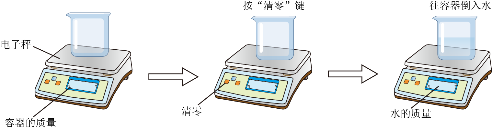

# Physics - 题目 269

**ID**: f006db55887d4868b5bb1da9b4d4ff85
**年级**: Grade 8
**难度**: Medium-Hard
**题型**: Experiment

## 题目
电子秤使用方便，测量结果直接由数字显示且有清零的功能，例如在某电子秤上放上245g的柱形容器，电子秤显示为245g，按清零键后，显示变为零；随后在容器中倒入50g水，电子秤显示50g，力学兴趣小组，用刻度尺、电子秤，分别改装密度计。​​​​​​​‌（1）改装实验①将柱形容器放在电子秤上清零，往容器内倒入适量水，读出电子秤示数m_{1}；②用刻度尺测出柱形容器内水的深度h_{1}并做好标记；③将柱形容器内水倒去，擦干，放到电子秤上称，往其中缓缓倒入待测液体，直至到标记处；④读出。则待测液体的密度 $ρ=$（用所测物理量符号和水的密度 $ρ$_{水}表示）。根据这种关系可以将电子秤测量质量的标度标成对应的密度，可以直接读出液体密度。（2）改装实验二：①将柱形容器放在电子秤上清零，往容器内倒入适量水，读出电子秤示数m_{1}；②用刻度尺测出柱形容器内水的深度h_{1}做好标记；③将柱形容器内水倒去，擦干，放到电子秤上清零，往其中缓缓倒入待测液体，直至电子秤示数仍为m_{1}；④测出。待测液体的密度 $ρ$ =（用所测物理量符号和水的密度 $ρ$_{水}表示）。根据这种关系可以在容器上标记对应密度，直接读出液体密度。

## 解答

1. （1）④将柱形容器内水倒去，擦干，放到电子秤上称，往其中缓缓倒入待测液体，直至到标记处，读出电子秤的示数 $m{{}_{2}}$ ，因为柱形容器的质量已经清零，所以液体的质量为 $m{{}_{2}}$ 。液体的体积等于水的体积，即液体的体积为 $V{{}_{液}}{\rm{=}}V{{}_{水}}=\frac {m{{}_{1}}}{ρ{{}_{水}}}$ ，则液体的密度
2. $ρ{{}_{液}}=\frac {m{{}_{液}}}{V{{}_{液}}}=\frac {m{{}_{2}}}{\frac {m{{}_{1}}}{ρ{{}_{水}}}}=\frac {m{{}_{2}}}{m{{}_{1}}}ρ{{}_{水}}$ 。
3. （2）④ 将柱形容器内水倒去，擦干，放到电子秤上清零，往其中缓缓倒入待测液体，直至电子秤示数仍为m_{1}，测出待测液体的深度h_{2}。此时液体的质量等于水的质量，设容器底面积为S， $m{{}_{1}}=ρ{{}_{水}}V{{}_{水}}=ρ{{}_{水}}Sh{{}_{1}}=ρ{{}_{液}}V{{}_{液}}=ρ{{}_{液}}Sh{{}_{2}}$  则液体密度 $ρ{{}_{液}}{\rm{=}}\frac {h{{}_{1}}}{h{{}_{2}}}ρ{{}_{水}}$ 。

## 知识点

**中文**:
  - 特殊方法测密度

**English**:
  - Special Methods for Measuring Density

---
