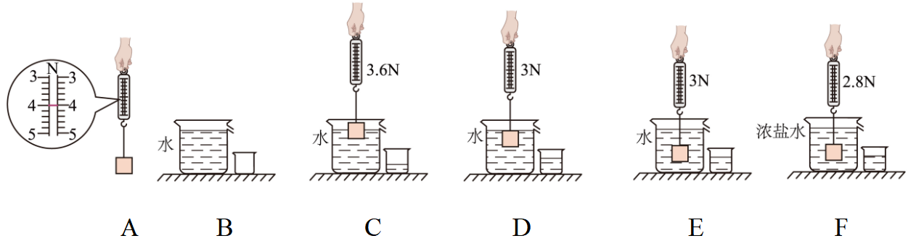
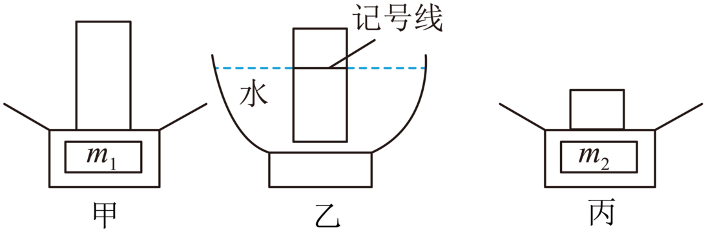

# Physics - 题目 33

**ID**: f126687d2ce14c0b87fc620f7cea8d50
**年级**: Grade 8
**难度**: Medium-Hard
**题型**: Experiment

## 题目
在探究浮力大小跟哪些因素有关时，小明进行了如图所示的实验。​​​​​​​‌（1）图D中，金属块所受的浮力为N；（2）比较两次实验，可探究物体浸没在液体中时，受到的浮力是否与浸入液体的深度有关；（3）分析实验过程及实验数据，可得出：①实验结论：浮力大小与物体排开液体的体积和有关；②实验C中，溢出水的质量为g；③金属块的体积为${\rm{c}}{\rm{m}}{^{{{3}}}}$ ，浓盐水的密度为${\rm{k}}{\rm{g}}/{\rm{m}}{^{3}}$ ；（4）【拓展】小明利用学到的知识在家仅用电子秤、一只碗和水（已知水的密度为 $ρ{{}_{水}}$ ），测量出了蜡块的密度，方法如图所示：①如图甲，用电子秤测出某蜡块的质量为 $m{{}_{1}}$ ；②如图乙，将蜡块放入水中，静止时蜡块竖直漂浮，在蜡块上记下水面对应的位置；③取出蜡块擦拭干净，并沿记号切去没入水中的部分（不计损耗），用电子秤测出剩余蜡块的质量为 $m{{}_{2}}$ ，如图丙所示。则蜡块密度的表达式为（用已知量和测量量表示）。

## 解答

1. （1）由图A知，弹簧测力计的分度值为0.2N，示数为4N，即金属块的重力 $G=4{\rm{N}}$ ；由图D知，弹簧测力计的示数 $F{{}_{4}}=3{\rm{N}}$ ，根据称重法 $F{{}_{浮}}=G-F{{}_{示}}$ 可得，图D中金属块所受的浮力 $F{{}_{浮4}}=G-F{{}_{4}}=4{\rm{N}}-3{\rm{N}}=1{\rm{N}}$ 。
2. （2）探究物体浸没在液体中时，受到的浮力是否与浸入液体的深度有关，要控制液体的密度和排开液体的体积相同，只改变物体浸入液体的深度，故比较D、E两次实验。
3. （3）①由A、B、C、D实验，液体的密度相同，D中排开液体的体积大，根据称重法可知，D中受到的浮力大，故得出浮力大小与物体排开液体的体积有关。由E、F实验，排开液体的体积相同，F中液体的密度大，F中受到的浮力大，故得出浮力大小与液体的密度有关。因此得出实验结论：浮力大小与物体排开液体的体积和液体的密度有关。
4. ②由A、C知，物体在C中受到的浮力 $F{{}_{浮3}}=G-F{{}_{3}}=4{\rm{N}}-3.6{\rm{N}}=0.4{\rm{N}}$ ，根据阿基米德原理 $F{{}_{浮}}=G{{}_{排}}=m{{}_{排}}g$ 可知，实验C中溢出水的质量 $m{{}_{排}}=\frac {F{{}_{浮3}}}{g}{\rm{=}}\frac {{{0}}{{.}}{{4}}{\rm{N}}}{{{1}}{{0}}{\rm{N}}{\rm{/}}{\rm{k}}{\rm{g}}}{\rm{=}}{{0}}{{.}}{{0}}{{4}}{\rm{k}}{\rm{g}}{\rm{=}}{{4}}{{0}}{\rm{g}}$ 。
5. ③由A、D知，物体浸没在水中时受到的浮力 $F{{}_{浮4}}=1{\rm{N}}$ ，由阿基米德原理 $F{{}_{浮}}=ρ{{}_{液}}gV{{}_{排}}$ 得，金属块的体积 $V=V{{}_{排}}=\frac {F{{}_{浮4}}}{ρ{{}_{水}}g}{\rm{=}}\frac {{{1}}{\rm{N}}}{{{1}}{{.}}{{0}}\times {{1}}{{0}}{^{{{3}}}}{\rm{k}}{\rm{g}}{\rm{/}}{\rm{m}}{^{{{3}}}}\times {{1}}{{0}}{\rm{N}}{\rm{/}}{\rm{k}}{\rm{g}}}{\rm{=}}{{1}}\times {{1}}{{0}}{^{{{-}}{{4}}}}{\rm{m}}{^{{{3}}}}{\rm{=}}{{1}}{{0}}{{0}}{\rm{c}}{\rm{m}}{^{{{3}}}}$ ；由A、F知，物体浸没在浓盐水中时受到的浮力 $F{{}_{浮6}}=G-F{{}_{6}}=4{\rm{N}}-2.8{\rm{N}}=1.2{\rm{N}}$ ，因物体浸没，故 $V{{}_{排}}=V$ ，根据阿基米德原理 $F{{}_{浮}}=ρ{{}_{液}}gV{{}_{排}}$ ，浓盐水的密度 $ρ{{}_{盐水}}=\frac {F{{}_{浮6}}}{gV}{\rm{=}}\frac {{{1}}{{.}}{{2}}{\rm{N}}}{{{1}}{{0}}{\rm{N}}{\rm{/}}{\rm{k}}{\rm{g}}\times {{1}}\times {{1}}{{0}}{^{{{-}}{{4}}}}{\rm{m}}{^{{{3}}}}}{\rm{=}}{{1}}{{.}}{{2}}\times {{1}}{{0}}{^{{{3}}}}{\rm{k}}{\rm{g}}{\rm{/}}{\rm{m}}{^{{{3}}}}$ 。
6. （3）由①、②知，蜡块漂浮时，浮力等于重力，即 $F{{}_{浮}}=G=m{{}_{1}}g$ ；由②、③知，切去的蜡块的质量 $m{{}_{切}}=m{{}_{1}}-m{{}_{2}}$ ，切去的蜡块体积等于漂浮时排开液体的体积，即 $V{{}_{排}}=V{{}_{切}}=\frac {m{{}_{切}}}{ρ{{}_{蜡}}}=\frac {m{{}_{1}}{{-}}m{{}_{2}}}{ρ{{}_{蜡}}}$ ；根据阿基米德原理 $F{{}_{浮}}=ρ{{}_{水}}gV{{}_{排}}$ ，有 $m{{}_{1}}g=ρ{{}_{水}}g\times \frac {m{{}_{1}}-m{{}_{2}}}{ρ{{}_{蜡}}}$ ，化简可得蜡块密度的表达式为 $ρ{{}_{蜡}}=\frac {m{{}_{1}}-m{{}_{2}}}{m{{}_{1}}}ρ{{}_{水}}$ 。

## 知识点

**中文**:
  - 利用浮力知识测密度
  - 探究影响浮力大小因素的实验

**English**:
  - Measuring Density using Buoyancy
  - Experiment: Factors Affecting Buoyancy

---
