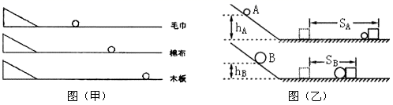

# Physics - 题目 425

**ID**: f1f762bfef34429e912c697625623f76
**年级**: Grade 8
**难度**: Medium-Hard
**题型**: Experiment

## 题目
小宇骑车时发现，不踩踏脚板，车也能滑行一段距离。​​​​​​​‌他在不同的路面上多次尝试后猜想：车滑行的距离可能与路面的粗糙程度和速度有关。为探究其中的奥秘，他在水平桌面上搭成一斜面，用小球做实验，并用毛巾、棉布、木板等改变水平桌面的粗糙程度。(1)为了探究小球在水平面上的滑行距离与速度的关系，小宇应先后三次将小球从斜面的（选填“同一”或“不同”，下同）高度处释放，比较小球在粗糙面上滑行的路程；(2)为探究小球滑行距离与水平面粗糙程度的关系。小宇先后三次将小球从斜面上的同一高度处释放，三次实验结果如图甲所示，由此得到结论：。小宇认为，通过进一步推理可以得出结论：运动的物体如果不受阻力作用，物体将；(3)为了模拟研究汽车超速带来的安全隐患，李斌同学设计了如图乙所示的探究实验：将A、B两个小球先后从同一装置，高分别为h_{A}、h_{B}的位置滚下同一粗糙水平面（m_{A}＜m_{B}，h_{A}＞h_{B}），推动小木块运动一段距离后静止。同组的小红认为他这样设计实验得出的结论有问题，理由是，若没有改正错误，此时在如图乙所示的①②两次实验中，木块移动过程中受到的摩擦力分别为f_{1}、f_{2}，则f_{1}f_{2}（选填“＞”“＜”或“＝”）。

## 解答

1. (1)[1][2]为了探究小球在水平面上的滑行距离与速度的关系，要控制水平面的粗糙程度相同，只改变速度的大小，故小宇应先后三次将小球从斜面的不同高度处释放，比较小球在相同粗糙面上滑行的路程。
2. (2)[3]为探究小球滑行距离与水平面粗糙程度的关系，应控制小球的初速度相等，小宇应先后三次将小球从斜面上的同一高度处释放；从毛巾、棉布到木板，接触面粗糙程度变小，接触面越光滑，阻力越小，通过的距离越长。
3. [4]通过进一步推理可以得出结论：运动的物体如果不受阻力作用，则物体将运动的无限远，物体将做匀速直线运动。
4. (3)[5]要模拟研究汽车超速带来的安全隐患，应该用速度不同但质量相同的小球去撞击木块，由图乙知，小球的质量不同，这种设计不合理，原因是没有控制两个小球的质量相等。
5. [6]因m_{A}＜m_{B}，根据G＝mg，A的重力小于B的重力，B木块对接触面的压力较大，因在接触面粗糙程度相同时，压力越大，滑动摩擦力越大，若没有改正错误，此时在如图乙所示的①②两次实验中，木块移动过程中受到的摩擦力分别为f_{1}、f_{2}，则f_{1}＜f_{2}。

## 知识点

**中文**:
  - 探究影响物体动能大小因素的实验
  - 阻力对物体运动影响的探究实验

**English**:
  - Experiment: Factors Affecting Kinetic Energy
  - Experiment: Effect of Resistance on Motion

---
