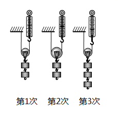

# Physics - 题目 2173

**ID**: fcb75cb56e4646e58621167b6d0800ec
**年级**: Grade 8
**难度**: Medium-Hard
**题型**: Experiment

## 题目
在“测量滑轮组机械效率”时，某小组利用自重不同的两个动滑轮进行了如图所示的3次测量，数据记录在下表中。​​​​​​​‌实验次数钩码总重/N动滑轮重/N钩码上升的高度/m拉力/N拉力移动的距离/m机械效率140.50.22.30.487.0 ${\rm{\%}}$240.90.22.50.480.0 ${\rm{\%}}$360.50.23.30.4（1）实验中，测绳端拉力F时，应尽量竖直向上拉动弹簧测力计，且在（填“静止”或“拉动过程中”）时读数。（2）完成表格中第3次数据的数据（保留1位小数）。（3）通过比较第两次实验数据（填实验序号），可知动滑轮的机械效率与动滑轮自重（填“有关”或“无关”）。（4）小明认为“同一机械，它的机械效率是一个定值”。通过比较第次和第次实验数据（填实验序号），可知他的观点是（填 “正确”或“错误”）。

## 解答

1. （1）在测绳端拉力时，需竖直向上匀速拉动测力计，且在拉动时读数。
2. （2）第3次实验测得的机械效率
3. $η=\frac {W{{}_{有用}}}{W{{}_{总}}}=\frac {Gh}{Fs}\times 100\%=\frac {6{\rm{N}}\times 0.2{\rm{m}}}{3.3{\rm{N}}\times 0.4{\rm{m}}}\times 100\%\approx 90.9\%$
4. （3）分析第1、2次实验，两次提升物体的重力相同，第2次实验的动滑轮较重，而机械效率较低，所以可得可知动滑轮的机械效率与动滑轮自重有关。
5. （4）比较1、3，同一个机械，动滑轮重力不变，提升的物体重力不同时，机械效率也不同，提的物体越重，机械效率越大，可知小明的观点是错误的。

## 知识点

**中文**:
  - 滑轮（组）的机械效率及其计算
  - 滑轮（组）的机械效率的测量实验

**English**:
  - Mechanical Efficiency of Pulleys and Calculations
  - Experiment: Measuring Mechanical Efficiency of Pulleys

---
