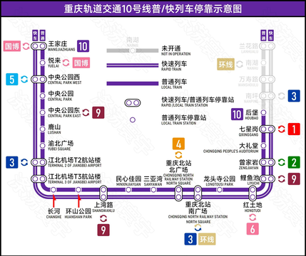

# Physics - 题目 1768

**ID**: 0bce388af05640a88ab240f94085745b
**年级**: Grade 8
**难度**: Medium-Hard
**题型**: Fill-in-the-blank

## 题目
重庆轨道交通10号线直快列车只停靠11个站，如图所示，便民出行，全程可节约18min，大礼堂站不是快车停靠站。​​​​​​​‌张家花园校区初二的小莉同学放学后来到大礼堂站准备乘地铁回家，当她站在站台上等待列车时，一列长120m的快车正以72km/h的速度匀速直线驶过车站，则列车经过小莉所需要的时间为s。当列车在进站前离小莉同学68m时，发出一鸣笛声，若鸣笛声持续时间为5.1s，则小莉同学听到鸣笛声的持续时间为s。（声音在空气中的速度为340m/s）

## 解答

1. 列车长度L=120m，速度v=72km/h=20m/s，列车经过小莉的时间为列车全长通过观察点的时间，即 $t=\frac {L}{v}=\frac {120{\rm{m}}}{20{\rm{m}}/{\rm{s}}}=6{\rm{s}}$ ；
2. 初始距离s_{0}​=68m，列车速度v=20m/s，鸣笛持续时间t=5.1s。声音速度v_{声}​=340m/s。声音传播时间随列车位置变化，导致小莉听到的持续时间与实际不同。鸣笛开始时：列车距离小莉68m，声音传播时间 $t{{}_{1}}=\frac {s{{}_{0}}}{v{{}_{声}}}=\frac {68{\rm{m}}}{340{\rm{m}}/{\rm{s}}}=0.2{\rm{s}}$ ，小莉在开始鸣笛时的0.2s后听到鸣笛声。鸣笛结束时列车移动距离 $s{{}_{车}}=vt{{}_{声}}=20{\rm{m}}/{\rm{s}}\times 5.1{\rm{s}}=102{\rm{m}}$ ，鸣笛停止时列车与小莉之间的距离 $s=s{{}_{0}}-s{{}_{车}}=68{\rm{m}}-102{\rm{m}}=-34{\rm{m}}$ ，则列车已超过小莉的位置。声音从34m外反向传播回来，所用时间 $t{{}_{2}}=\frac {s}{v{{}_{声}}}=\frac {34{\rm{m}}}{340{\rm{m}}/{\rm{s}}}=0.1{\rm{s}}$ ，小莉同学听到鸣笛声的持续时间 $t{{}_{持续}}=t-t{{}_{1}}+t{{}_{2}}=5.1{\rm{s}}-0.2{\rm{s}}+0.1{\rm{s}}=5.0{\rm{s}}$ 。

## 知识点

**中文**:
  - 速度的综合计算

**English**:
  - Comprehensive Velocity Calculations

---
