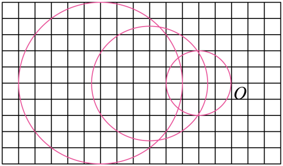

# Physics - 题目 805

**ID**: 24e9be87ed4640baae4497d51a673ce7
**年级**: Grade 8
**难度**: Medium-Hard
**题型**: Fill-in-the-blank

## 题目
一架飞机由西向东作匀速直线运动，飞行的同时以相等的时间间隔向各个方向同时发出频率f=1000Hz的声波。​​​​​​​‌某一时刻的声波图像如图所示（图中每个正方格的边长相等），则该飞机的飞行速度为m/s，在飞机正后方的观测者所听到的声波频率为Hz。（声波速度为340米/秒）

## 解答

1. 设飞机每隔时间t向外发出一次声音，图中每个正方格的边长为a，由图知飞机第一次发出的声音通过的路程为5a，第三次发出的声音通过的路程为2a，说明在2t时间内，声音通过的路程为s=5a-2a=3a，则有3a=v_{声}×2t......①，由图知，第一次发声与第三次发声之间飞机通过的路程为6a，说明在2t时间内飞机通过的路程为6a，则有6a=v_{飞机}×2t......②，由①②知v_{飞机}=2v_{声}=2×340m/s=680m/s，由飞机发出的声波频率为1000Hz知，声波相邻两次波峰之间的时间间隔（即声波的周期）为 $T=\frac {1}{f}=\frac {1}{1000{\rm{H}}{\rm{z}}}=0.001{\rm{s}}$ ，设飞机发出声音的第一个波峰时与正后方的观察者相距为s，则该波峰到达观察者的时间为 $t^{′}=\frac {s}{v{{}_{声}}}$ ，飞机发出声音的第二个波峰时与正后方的观察者之间的距离为s+v_{飞机}×T=s+2v_{声}×T，该波峰到达观察者的时间为 $t^{′′}=\frac {s+2v{{}_{声}}\times T}{v{{}_{声}}}$ ，则声音到达观察者的时间间隔 $T^{′}=t^{′′}+T-t^{′}=\frac {s+2v{{}_{声}}\times T}{v{{}_{声}}}+T-\frac {s}{v{{}_{声}}}=3T=3\times 0.001{\rm{s}}=0.003{\rm{s}}$ ，则观测者所听到的声波频率为
2. $f^{′}=\frac {1}{T^{′}}=\frac {1}{0.003{\rm{s}}}=333{\rm{H}}{\rm{z}}$

## 知识点

**中文**:
  - 速度的综合计算
  - 音调与频率的关系

**English**:
  - Comprehensive Velocity Calculations
  - Relationship between Pitch and Frequency

---
