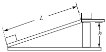

# Physics - 题目 1193

**ID**: 283901de46834bd8823b7b1a32651309
**年级**: Grade 8
**难度**: Medium-Hard
**题型**: Fill-in-the-blank

## 题目
如图，用大小为F（图中未画出）的力将一个重为G的木箱（不计木箱的长度），沿长为L的斜面推上高为h的平台上，比直接举上去更容易些，说明利用斜面来搬运物体是（选填“省力”或“费力”）的；此过程中斜面对木箱的摩擦力大小是（用字母表示）。​​​​​​​‌

## 解答

1. 用大小为F的力将一个重为G的木箱，沿长为L的斜面推上高为h的平台上，比直接举上去更容易些，是因为斜面本质上是一个省力杠杆，所以要省力一些。
2. 斜面的有用功为
3. $W{{}_{有}}=Gh$
4. 总功为
5. $W{{}_{总}}=FL$
6. 克服摩擦力做的额外功为
7. $W{{}_{额}}=W{{}_{总}}-W{{}_{有}}=FL-Gh$
8. 则摩擦力为
9. $f=\frac {W{{}_{额}}}{L}=\frac {FL-Gh}{L}$

## 知识点

**中文**:
  - 斜面与轮轴
  - 有用功、额外功和总功的计算

**English**:
  - Inclined Plane and Wheel & Axle
  - Calculation of Useful, Extra, and Total Work

---
