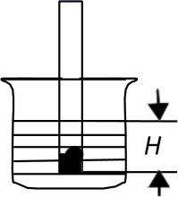

# Physics - 题目 2575

**ID**: 45f389430c6740879b5c584a2734af98
**年级**: Grade 8
**难度**: Medium-Hard
**题型**: Fill-in-the-blank

## 题目
在综合实践活动中，小明用吸管制成一简易密度计。​​​​​​​‌如图所示，分别将密度计放入水和酒精中，吸管浸入的深度分别为H和h，在吸管上标出对应的刻度线分别为A和B，用ρ_{1}表示水的密度，则酒精的密度ρ_{2}=。盐水的密度ρ_{3}，对应的刻度线C，则A、B、C在吸管上的刻度顺序由上而下是（已知 $ρ{{}_{3}}>ρ{{}_{1}}>ρ{{}_{2}}$ ），小明发现密度计上A、B之间的距离偏小，为了增大刻度线之间的距离，你的方案是。

## 解答

1. （1）由于密度计不管是在水中还是在酒精中，都是漂浮状态，所以
2. $F{{}_{浮水}}=F{{}_{浮酒精}}=G$
3. 密度计的底面积为S，已知吸管浸入水中的深度为H，浸入液体中的深度为h，则
4. $ρ{{}_{1}}gSh{{}_{水}}=ρ{{}_{2}}gSh{{}_{酒精}}$
5. 即：
6. $ρ{{}_{1}}gSH=ρ{{}_{2}}gSh$
7. 解得
8. $ρ{{}_{2}}=\frac {H}{h}ρ{{}_{1}}$
9. 由F_{浮水}=F_{浮液}=G则
10. $ρ{{}_{1}}gSh{{}_{水}}=ρ{{}_{液}}gSh{{}_{液}}$
11. 解得
12. $h{{}_{液}}=\frac {ρ{{}_{1}}}{ρ{{}_{液}}}h{{}_{1}}$
13. 液体密度越大，h_{液}越小，标记为BAC
14. 密度计上A、B两刻度线间距离偏小，因此为了使测量结果更精确，应使密度计浸入液体的体积多一些，因此可减小吸管的横截面积（增加配重的质量）。
15. 【点睛】
16. 此本题考查了液体密度的测量涉及到物体浮沉条件、阿基米德原理等，会判断密度计上两刻度线之间的距离变化。

## 知识点

**中文**:
  - 密度计的原理及应用
  - 物体的浮沉条件及其应用

**English**:
  - Principle and Application of Hydrometer
  - Floating/Sinking Conditions and Applications

---
