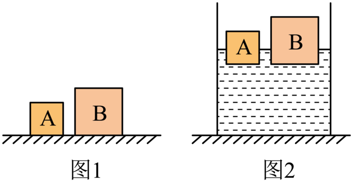

# Physics - 题目 1004

**ID**: 4c762c4cd1dd41489b06bb81b89a53e6
**年级**: Grade 8
**难度**: Medium-Hard
**题型**: Fill-in-the-blank

## 题目
现有两个质量相等的实心正方体A和B。​​​​​​​‌（1）将正方体A和B放在水平地面上，如图1所示，它们对水平地面的压强关系为。

## 解答

1. （1）由题知两个实心正方体A和B质量相同，由 $G=mg$ 得 $G{{}_{{\rm{A}}}}=G{{}_{{\rm{B}}}}$
2. 在水平地面上，对地面的压力等于重力即 $F=G$ 所以两正方体对地面的压力 $F{{}_{{\rm{A}}}}=F{{}_{{\rm{B}}}}$
3. 由图a可知 $S{{}_{{\rm{A}}}}＜S{{}_{{\rm{B}}}}$ 由 $p=\frac {F}{S}$ 知，两正方体对地面的压强 $p{{}_{{\rm{A}}}}＞p{{}_{{\rm{B}}}}$ ，故A符合题意，B、C不符合题意。
4. （2）实心正方体A和B质量相同，由图1可知 $V{{}_{{\rm{A}}}}<V{{}_{{\rm{B}}}}$ ，由 $ρ=\frac {m}{V}$ 知， $ρ{{}_{{\rm{A}}}}>ρ{{}_{{\rm{B}}}}$ ，由沉浮条件可知，若 $ρ{{}_{{\rm{A}}}}>ρ{{}_{{\rm{B}}}}>ρ{{}_{水}}$ ，则AB都沉底；若 $ρ{{}_{水}}>ρ{{}_{{\rm{A}}}}>ρ{{}_{{\rm{B}}}}$ ，则AB都都漂浮；若 $ρ{{}_{{\rm{A}}}}>ρ{{}_{水}}>ρ{{}_{{\rm{B}}}}$ ，则B漂浮、A沉底，所以不可能出现A漂浮、B沉底的现象，故B符合题意，A、C不符合题意。
5. （3）B．由于A、B的质量相同，则A、B的重力相同，且都漂浮在水面上，由沉浮条件可知，A、B受到的浮力相同，由 $F{{}_{浮}}=ρgV{{}_{排}}$ 知，A、B排开水的体积相同，故B错误；
6. A．由图2知，A、B都漂浮在水面上，则 $F{{}_{浮A}}=G{{}_{{\rm{A}}}}$ ， $F{{}_{浮B}}=G{{}_{{\rm{B}}}}$
7. 由阿基米德原理可知， $ρ{{}_{水}}gV{{}_{排A}}=ρ{{}_{{\rm{A}}}}gV{{}_{{\rm{A}}}}$ ， $ρ{{}_{水}}gV{{}_{排B}}=ρ{{}_{{\rm{B}}}}gV{{}_{{\rm{B}}}}$
8. 则物体A、B的密度 $ρ{{}_{{\rm{A}}}}=\frac {ρ{{}_{水}}V{{}_{排A}}}{V{{}_{{\rm{A}}}}}$ ， $ρ{{}_{{\rm{B}}}}=\frac {ρ{{}_{水}}V{{}_{排B}}}{V{{}_{{\rm{B}}}}}$
9. A、B排开水的体积相同，由图2知，B的体积大于A的体积，所以A排开水体积与A的总体积比例较大，所以物体A的密度较大，故A错误；
10. CD．由于A、B受到的浮力相同，由浮力产生的原因知，正方体A和正方体B下表面受到水的压力一定相等，由于 $S{{}_{{\rm{A}}}}＜S{{}_{{\rm{B}}}}$ ，由 $p=\frac {F}{S}$ 可知，正方体A下表面的压强大于正方体B下表面受到水的压强，故C错误，D正确。

## 知识点

**中文**:
  - 压强大小的比较
  - 密度公式的应用
  - 阿基米德原理的应用
  - 物体的浮沉条件及其应用

**English**:
  - Comparing Pressure
  - Application of Density Formula
  - Applications of Archimedes' Principle
  - Floating/Sinking Conditions and Applications

---
