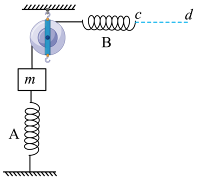

# Physics - 题目 1466

**ID**: 5940f42ca7844a74b401b130b25cabe7
**年级**: Grade 8
**难度**: Medium-Hard
**题型**: Fill-in-the-blank

## 题目
如图所示，劲度系数为k_{1}的轻质弹簧A一端固定在地面上并竖直放置，质量为m的物块压在弹簧A上，用一细绳跨过定滑轮，一端与m相连，另一端与劲度系数为k_{2}的轻质弹簧B相连。​​​​​​​‌现用手握住弹簧B的右端使其位于c点时，弹簧B恰好呈水平且没有形变，将弹簧B的右端水平拉到d点时，弹簧A恰好没有形变。已知：k_{2}＜k_{1}，则c、d之间的距离为。

## 解答

1. 现用手握住弹簧B的右端使其位于c点时，弹簧B恰好没有形变，说明弹簧B没有压力，由胡克定律可得，弹簧A压缩
2. $x{{}_{1}}=\frac {mg}{k{{}_{1}}}$
3. 将弹簧B的右端水平拉到d点时，弹簧A恰好没有形变，说明弹簧B中拉力等于mg，弹簧B拉伸
4. $x{{}_{2}}=\frac {mg}{k{{}_{2}}}$
5. 所以c、d之间的距离为
6. $x=x{{}_{1}}+x{{}_{2}}=\frac {mg}{k{{}_{1}}}+\frac {mg}{k{{}_{2}}}=\frac {\left ({k{{}_{1}}+k{{}_{2}}}\right )mg}{k{{}_{1}}k{{}_{2}}}$

## 知识点

**中文**:
  - 弹力
  - 弹簧测力计原理及其使用

**English**:
  - Elastic Force
  - Principle and Use of Spring Dynamometer

---
