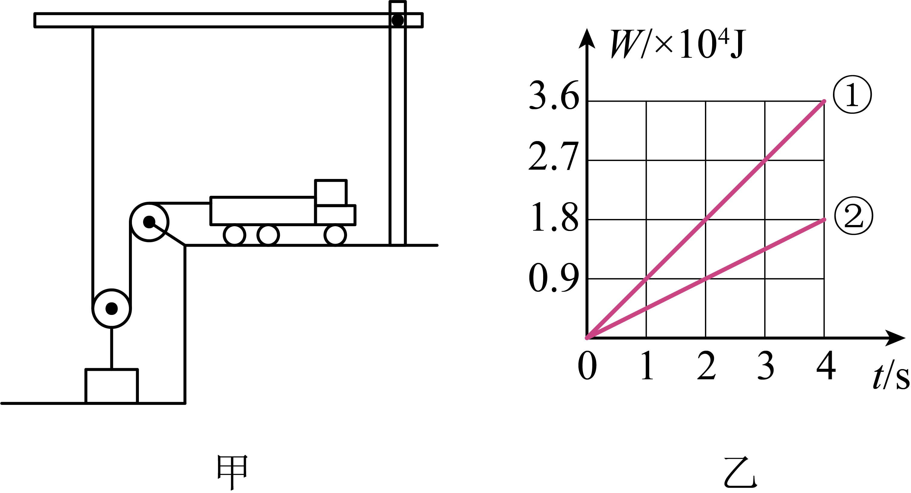

# Physics - 题目 306

**ID**: 7c3d8529adc04ae683130d3991a3f989
**年级**: Grade 8
**难度**: Medium-Hard
**题型**: 填空题：本大题共7小题，共17分。

## 题目
某工程组设计的利用汽车提升重物的装置如上图甲所示。​​​​​​​‌图中支架固定在水平地面上，当汽车以拉力 $F{{}_{1}}$ 匀速竖直提升物体A的过程中，物体A的速度为 $v{{}_{1}}$ ，物体A的重为 $G{{}_{1}}$ ，滑轮组的机械效率为 $η{{}_{1}}$ 。当汽车以拉力 $F{{}_{2}}$ 匀速竖直提升物体B的过程中，物体B的速度为 $v{{}_{2}}$ ，物体B的重为 $G{{}_{2}}$ ，滑轮组的机械效率为 $η{{}_{2}}$ 。拉力 $F{{}_{1}}$ 、 $F{{}_{2}}$ 做的功随时间变化的图像分别如图乙中①、②所示。已知： $v{{}_{1}}=3v{{}_{2}}$ ， $12G{{}_{1}}=7G{{}_{2}}$ ，不计绳的质量，不计滑轮与轴的摩擦。则 $F{{}_{1}}:F{{}_{2}}$ 为，提升物体A时的机械效率 $η{{}_{1}}$ 为。

## 解答

1. 由W-t图像可知，t=2s时，W_{1}=1.8×10^{4}J，W_{2}=0.9×10^{4}J，由 $P=\frac {W}{t}$ 可得，相同时间内两次汽车拉力的功率之比 $\frac {P{{}_{1}}}{P{{}_{2}}}=\frac {\frac {W{{}_{1}}}{t}}{\frac {W{{}_{2}}}{t}}=\frac {W{{}_{1}}}{W{{}_{2}}}=\frac {1.8\times 10{^{4}}{\rm{J}}}{0.9\times 10{^{4}}{\rm{J}}}=2∶1$
2. 由 $P=\frac {W}{t}=\frac {Fs}{t}=Fv$
3. 可得，汽车两次的拉力之比 $\frac {F{{}_{1}}}{F{{}_{2}}}=\frac {\frac {P{{}_{1}}}{v{{}_{1}}}}{\frac {P{{}_{2}}}{v{{}_{2}}}}=\frac {P{{}_{1}}}{P{{}_{2}}}\times \frac {v{{}_{2}}}{v{{}_{1}}}=\frac {P{{}_{1}}}{P{{}_{2}}}\times \frac {v{{}_{2}}}{3v{{}_{2}}}=\frac {2}{1}\times \frac {1}{3}=2∶3$
4. 由图可知，n=2，所以有 $η=\frac {W{{}_{有}}}{W{{}_{总}}}=\frac {Gh}{Fs}=\frac {Gh}{Fnh}=\frac {G}{nF}=\frac {G}{2F}$
5. 即 $\frac {η{{}_{1}}}{η{{}_{2}}}=\frac {\frac {G{{}_{1}}}{2F{{}_{1}}}}{\frac {G{{}_{2}}}{2F{{}_{2}}}}=\frac {G{{}_{1}}}{G{{}_{2}}}\times \frac {F{{}_{2}}}{F{{}_{1}}}=\frac {7}{12}\times \frac {3}{2}=\frac {7}{8}$
6. 由于不计绳的重力，不计滑轮与轴的摩擦，所以滑轮组的机械效率 $η=\frac {W{{}_{有}}}{W{{}_{总}}}=\frac {W{{}_{有}}}{W{{}_{有}}+W{{}_{额}}}\frac {Gh}{Gh+G{{}_{动}}h}=\frac {G}{G+G{{}_{动}}}$
7. 即 $\frac {η{{}_{1}}}{η{{}_{2}}}=\frac {\frac {G{{}_{1}}}{G{{}_{1}}+G{{}_{动}}}}{\frac {G{{}_{2}}}{G{{}_{2}}+G{{}_{动}}}}=\frac {G{{}_{1}}}{G{{}_{2}}}\times \frac {G{{}_{2}}+G{{}_{动}}}{G{{}_{1}}+G{{}_{动}}}=\frac {7}{12}\times \frac {G{{}_{2}}+G{{}_{动}}}{G{{}_{1}}+G{{}_{动}}}=\frac {7}{8}$
8. 整理可得 $G{{}_{动}}=2G{{}_{2}}-3G{{}_{1}}=2\times \frac {12}{7}G{{}_{1}}-3G{{}_{1}}=\frac {3}{7}G{{}_{1}}$
9. 则 $η{{}_{1}}=\frac {G{{}_{1}}}{G{{}_{1}}+G{{}_{动}}}\times 100\%=\frac {G{{}_{1}}}{G{{}_{1}}+\frac {3}{7}G{{}_{1}}}\times 100\%=70\%$

## 知识点

**中文**:
  - 滑轮（组）
  - 滑轮（组）的机械效率及其计算

**English**:
  - Pulleys (Systems)
  - Mechanical Efficiency of Pulleys and Calculations

---
