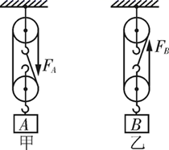

# Physics - 题目 2442

**ID**: 92468ffdd6f6425abee9636b0ac10afd
**年级**: Grade 8
**难度**: Medium-Hard
**题型**: Fill-in-the-blank

## 题目
如图，用相同的滑轮安装成甲、乙两种装置，分别用F_{A}、F_{B}匀速提升A、B两物体，已知G_{A}=38N，G_{B}=60N，不计绳重和摩擦，η_{甲}η_{乙}（选填“>”“=”或“<”）；若F_{A}=F_{B}，则动滑轮的重力G_{动}=N。​​​​​​​‌

## 解答

1. 不计绳重和摩擦，克服物体重力做的功为有用功，克服物体重力和动滑轮重力做的功为总功，则滑轮组的机械效率
2. $η=\frac {W{{}_{有}}}{W{{}_{总}}}\times 100\%=\frac {Gh}{(G+G{{}_{动}})h}\times 100\%=\frac {G}{G+G{{}_{动}}}\times 100\%=\frac {1}{1{\rm{+}}\frac {G{{}_{动}}}{G}}{\rm{\;}}\times 100\%$
3. 动滑轮的重力G_{动}不变，物体的重力G越大，滑轮组的机械效率越大，因为
4. G_{A}＜G_{B}
5. 所以
6. η_{甲}＜η_{乙}
7. 甲图中滑轮组的动滑轮绕2段绳，乙图中滑轮组的动滑轮绕3段绳，所以
8. F_{A}= $\frac {1}{2}$ (G_{A}+G_{动})
9. F_{B}= $\frac {1}{3}$ (G_{B}+G_{动})
10. F_{A}=F_{B}
11. $\frac {1}{2}$ (G_{A}+G_{动})= $\frac {1}{3}$ (G_{B}+G_{动})
12. $\frac {1}{2}$ ×(38N+G_{动})= $\frac {1}{3}$ ×(60N+G_{动})
13. G_{动}=6N

## 知识点

**中文**:
  - 增大或减小机械效率的方法
  - 滑轮组及其工作特点

**English**:
  - Methods to Increase or Decrease Mechanical Efficiency
  - Pulley Systems and Operating Characteristics

---
