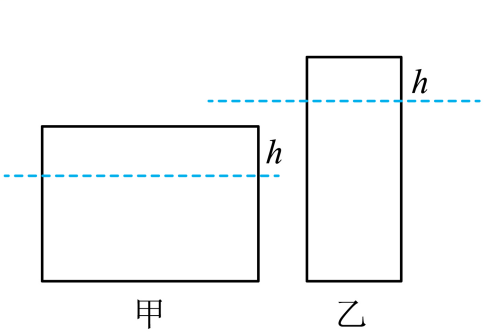

# Physics - 题目 2860

**ID**: 98b61843ea0e4a40a2f719f0c61b52da
**年级**: Grade 8
**难度**: Medium-Hard
**题型**: Fill-in-the-blank

## 题目
如图所示，现有两个底面积均为正方形的长方体甲和乙放在水平桌面上，其质量相等。​​​​​​​‌若分别沿水平方向切去相同的高度h，则甲和乙剩下的质量 $m{{}_{甲}}$$m{{}_{乙}}$ 。若分别沿竖直方向切去厚度为 $h{{}_{甲}}、h{{}_{乙}}$ 后，甲和乙两物体剩余的质量相等，则 $h{{}_{甲}}$$h{{}_{乙}}$ （两空均选填“大于”“小于”或“等于”）。

## 解答

1. 设甲乙的质量均为 $m$ ，高度分别为 $h{{}_{甲}}{^{^{′}}}$ 、 $h{{}_{乙}}{^{^{′}}}$ ，长度分别为 $l{{}_{甲}}$ 、 $l{{}_{乙}}$ 。若分别沿水平方向切去相同的高度h，则甲和乙剩下的质量分别为 $m{{}_{甲}}=\left ({1-\frac {h}{h{{}_{甲}}{^{^{′}}}}}\right )m$ ， $m{{}_{乙}}=\left ({1-\frac {h}{h{{}_{乙}}{^{^{′}}}}}\right )m$ ，由图可知 $h{{}_{甲}}{^{^{′}}}<h{{}_{乙}}{^{^{′}}}$ ，所以甲和乙剩下的质量 $m{{}_{甲}}<m{{}_{乙}}$ ；若分别沿竖直方向切去厚度为 $h{{}_{甲}}、h{{}_{乙}}$ 后，甲和乙两物体剩余的质量相等，则有 $\left ({1-\frac {h{{}_{甲}}}{l{{}_{甲}}}}\right )m=\left ({1-\frac {h{{}_{乙}}}{l{{}_{乙}}}}\right )m$ ，由图可知 $l{{}_{甲}}>l{{}_{乙}}$ ，所以 $h{{}_{甲}}>h{{}_{乙}}$ 。
2. 

## 知识点

**中文**:
  - 密度综合计算

**English**:
  - Comprehensive Density Calculations

---
