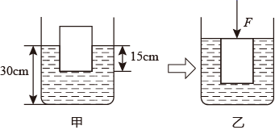

# Physics - 题目 1363

**ID**: ab00e040dd8b49158a8429daa35664bb
**年级**: Grade 8
**难度**: Medium-Hard
**题型**: Fill-in-the-blank

## 题目
一圆柱体物体高 $25{\rm{c}}{\rm{m}}$ ，底面积为 $20{\rm{c}}{\rm{m}}{^{2}}$ ，图中烧杯底面积为 $50{\rm{c}}{\rm{m}}{^{2}}$ （g取 $10{\rm{N}}/{\rm{k}}{\rm{g}}$ ）（1）（漂浮状态）如图甲所示将物块放入水中，物块所受浮力为N。​​​​​​​‌（2）（浸没状态）如图乙所示，用力F缓慢向下压物块使其恰好完全浸没在水中（水未溢出），施加的压力F为N。

## 解答

1. （1）甲图中，物块放入水中排开水的体积
2. V_{排}=Sh=20cm^{2}$\times $ 15cm=300cm^{3}=3 $\times $ 10^{-4}m^{3}
3. 物块受到的浮力
4. F_{浮}= $ρ$_{水}gV_{排}=1 $\times $ 10^{3}kg/m^{3}$\times $ 10N/kg $\times $ 3 $\times $ 10^{-4}m^{3}=3N
5. （2）甲图中物块漂浮，物块受到的浮力等于自身的重力，则物块的重力为
6. G=F_{浮}=3N
7. 物块恰好完全浸没在水中时排开水的体积为
8. $V^{′}{{{}_{排}}}$_{'}=Sh'=20cm^{2}$\times $ 25cm=500cm^{3}=5 $\times $ 10^{-4}m^{3}
9. 物块完全浸没水中时受到的浮力为
10. $F^{′}{{{}_{浮}}}=ρ{{}_{水}}gV^{′}{{{}_{排}}}$  =1.0 $\times $ 10^{3}kg/m^{3}$\times $ 10N/kg $\times $ 5 $\times $ 10^{-4}m^{3}=5N
11. 使物块完全浸没水中，施加的压力为
12. F= $F^{′}{{}_{浮}}-G$ =5N-3N=2N

## 知识点

**中文**:
  - 浮力大小的计算

**English**:
  - Calculation of Buoyancy

---
