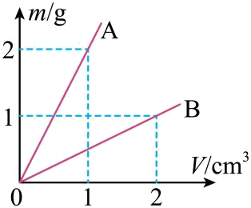

# Physics - 题目 2166

**ID**: bba824d3312e435c8821635e693053de
**年级**: Grade 8
**难度**: Medium-Hard
**题型**: Fill-in-the-blank

## 题目
如图为A、B两种材料的质量与体积的关系图像，则ρ_{A}：ρ_{B}=。​​​​​​​‌若把A、B两种物质等体积混合，则混合物的密度为g/cm^{3}（假设混合后总体积不变）。若把A、B两种物质等质量混合，则混合物的密度为g/cm^{3}（假设混合后总体积不变）。现用A、B两种材料分别制成等体积的甲、乙两物体，若甲、乙质量相等，则（选填“甲”或“乙”）物体一定是空心的。

## 解答

1. 根据图像知，A质量2g，体积为1cm^{3}；B质量1g，体积为2cm^{3}，A、B两种材料的密度分别为 $ρ{{}_{{\rm{A}}}}=\frac {m{{}_{{\rm{A}}}}}{V{{}_{{\rm{A}}}}}=\frac {{{2}}{\rm{g}}}{{{1}}{\rm{c}}{\rm{m}}{^{{{3}}}}}=2{\rm{g}}{\rm{/}}{\rm{c}}{\rm{m}}{^{3}}$ ， $ρ{{}_{{\rm{B}}}}=\frac {m{{}_{{\rm{B}}}}}{V{{}_{{\rm{B}}}}}=\frac {{{1}}{\rm{g}}}{{{2}}{\rm{c}}{\rm{m}}{^{{{3}}}}}=0.5{\rm{g}}{\rm{/}}{\rm{c}}{\rm{m}}{^{{{3}}}}$
2. $\frac {ρ{{}_{{\rm{A}}}}}{ρ{{}_{{\rm{B}}}}}=\frac {{{2}}{\rm{g}}{\rm{/}}{\rm{c}}{\rm{m}}{^{{{3}}}}}{{{0}}{{.}}{{5}}{\rm{g}}{\rm{/}}{\rm{c}}{\rm{m}}{^{{{3}}}}}=\frac {4}{1}$
3. 若把A、B两种物质等体积混合，则混合物的密度为 $ρ=\frac {m{{}_{{\rm{A}}}}+m{{}_{{\rm{B}}}}}{2V}=\frac {ρ{{}_{{\rm{A}}}}V+ρ{{}_{{\rm{B}}}}V}{2V}=\frac {2{\rm{g}}{\rm{/}}{\rm{c}}{\rm{m}}{^{3}}\times V+0.5{\rm{g}}{\rm{/}}{\rm{c}}{\rm{m}}{^{3}}\times V}{2V}=1.25{\rm{g}}{\rm{/}}{\rm{c}}{\rm{m}}{^{3}}$
4. 若把A、B两种物质等质量混合，设A、B两种物质等质量m混合时，则混合物的密度为 $ρ^{′}=\frac {2m}{\frac {m}{ρ{{}_{{\rm{A}}}}}+\frac {m}{ρ{{}_{{\rm{B}}}}}}=\frac {2ρ{{}_{{\rm{A}}}}ρ{{}_{{\rm{B}}}}}{ρ{{}_{{\rm{A}}}}+ρ{{}_{{\rm{B}}}}}=\frac {2\times 2{\rm{g}}{\rm{/}}{\rm{c}}{\rm{m}}{^{3}}\times 0.5{\rm{g}}{\rm{/}}{\rm{c}}{\rm{m}}{^{3}}}{2{\rm{g}}{\rm{/}}{\rm{c}}{\rm{m}}{^{3}}+0.5{\rm{g}}{\rm{/}}{\rm{c}}{\rm{m}}{^{3}}}=0.8{\rm{g}}{\rm{/}}{\rm{c}}{\rm{m}}{^{3}}$
5. 甲、乙质量相等，甲的密度大于乙的密度，由 $ρ=\frac {m}{V}$ 可知，甲物质的体积小于乙。而甲、乙物体的体积相等，则甲物体一定是空心的。

## 知识点

**中文**:
  - 空心、混合物质的密度计算

**English**:
  - Density Calculation of Hollow/Mixed Substances

---
