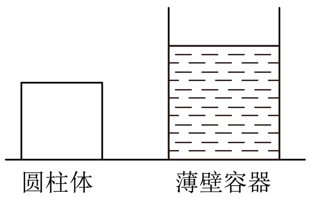

# Physics - 题目 2987

**ID**: c5ac32e3c9d64aa689d5f88211e26276
**年级**: Grade 8
**难度**: Medium-Hard
**题型**: Fill-in-the-blank

## 题目
如图所示，将底面积为100cm^{2}的圆柱体放在水平桌面上。​​​​​​​‌当把另一密度为0.5×10^{3}kg/m^{3}、质量为75g的圆柱形物体A竖直放在圆柱体的正上方时，圆柱体对桌面压强的变化量为∆p_{1}，则物体A的体积为m^{3}，∆p_{1}为Pa；桌面上还有一个底面积为150cm^{2}、内装有某液体的圆柱形容器（容器壁厚和质量均忽略不计）。当把物体A竖直放入容器中，并用细针将它压到刚好浸没在液体中时（液体未溢出，物体A没有接触到容器底部），液体对容器底部压强的变化量为∆p2，已知∆p_{1}︰∆p_{2}＝5︰6，则容器中液体的密度为kg/m^{3}（g取10N/kg）。

## 解答

1. [1]物体A的质量为75g，物体A的密度为0.5×10^{3}kg/m^{3}，则物体A的体积
2. $V{{}_{物}}=\frac {m{{}_{A}}}{ρ{{}_{A}}}=\frac {75\times 10{^{-3}}{\rm{k}}{\rm{g}}}{0.5\times 10{^{3}}{\rm{k}}{\rm{g}}{\rm{/}}{\rm{m}}{^{{\rm{3}}}}}=1.5\times 10{^{-4}}{\rm{m}}{^{{\rm{3}}}}$
3. [2]将质量为75g的物体A放在圆柱体的正上方时，圆柱体对桌面压强的变化量为
4. $Δp{{}_{1}}=\frac {ΔF}{S{{}_{1}}}=\frac {G{{}_{{\rm{A}}}}}{S{{}_{1}}}=\frac {m{{}_{{\rm{A}}}}g}{S{{}_{1}}}=\frac {0.075kg\times 10{\rm{N}}/kg}{100\times 10{^{-4}}{\rm{m}}{^{2}}}\frac {0.75{\rm{N}}}{100\times 10{^{-4}}{\rm{m}}{^{2}}}=75{\rm{P}}{\rm{a}}$
5. [3]已知△p_{1}︰△p_{2}＝5︰6，故液体对容器底部压强的变化量为
6. $\Delta p{{}_{2}}=\frac {6}{5}\Delta p{{}_{1}}=\frac {6}{5}\times 75{\rm{P}}{\rm{a}}=90{\rm{P}}{\rm{a}}$
7. 容器底部增加的压力
8. $\Delta F=Δp{{}_{2}}S{{}_{2}}=90{\rm{P}}{\rm{a}}\times 150\times 10{^{﹣4}}{\rm{m}}{^{{\rm{2}}}}=1.35{\rm{N}}$
9. 根据力的相互作用性，浮力的反作用力为物体对液体施加的压力，大小等于液体对容器底部增加的压力，即物体受到浮力大小 $F{{}_{浮}}=ΔF=1.35{\rm{N}}$ ，因物体A刚好浸没在液体中，根据阿基米德原理可得
10. $F{{}_{浮}}=1.35{\rm{N}}=ρ{{}_{液}}gV{{}_{排}}=ρ{{}_{液}}gV{{}_{A}}$
11. 则液体的密度
12. $ρ{{}_{液}}=\frac {F{{}_{浮}}}{V{{}_{A}}g}=\frac {1.35{\rm{N}}}{1.5\times 10{^{-4}}{\rm{m}}{^{{\rm{3}}}}\times 10{\rm{N}}{\rm{/}}{\rm{k}}{\rm{g}}}=0.9\times 10{^{3}}{\rm{k}}{\rm{g}}{\rm{/}}{\rm{m}}{^{{\rm{3}}}}$

## 知识点

**中文**:
  - 固体压强的判断与计算
  - 液体压强的判断与计算

**English**:
  - Determination and Calculation of Solid Pressure
  - Determination and Calculation of Liquid Pressure

---
