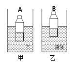

# Physics - 题目 1919

**ID**: cf111281f7fb4cd591653792539eef30
**年级**: Grade 8
**难度**: Medium-Hard
**题型**: Fill-in-the-blank

## 题目
水平台面上有两个相同的规则形状容器甲、乙，分别盛有水和另一种液体。​​​​​​​‌两个相同的瓶子A、B中盛有同样多的同种果汁（瓶子和瓶盖的质量、厚度均不计），分别放入两个容器中，静止时两个容器中液面刚好相平，如图所示。此时，A受到的浮力为F_{浮}_{A}，水对容器底部的压强为p_{1}，甲容器对地面压力为F_{1}；B受到的浮力为F_{浮}_{B}，液体对容器底部的压强为p_{2}，乙容器对地面压力为F_{2}，测量出乙图中此时B瓶内、外液面的高度差为△h_{1}。则F_{浮}_{A}（大于/等于/小于）F_{浮}_{B}、p_{1}（大于/等于/小于）p_{2}、F_{1}（大于/等于/小于）F_{2}。若将图乙的瓶子B倒放在液体中，瓶子静止时竖直漂浮，测出此时小瓶B内、外液面的高度差为△h_{2}，则△h_{1}（大于/等于/小于）△h_{2}。

## 解答

1. [1]两个相同的瓶子A、B中盛有同样多的同种果汁（瓶子和瓶盖的质量、厚度均不计），则A、B质量相等，重力相等，A、B在两种液体中均处于漂浮状态，两者受到的浮力都等于重力，而重力相等，则浮力也相等。
2. [2]由阿基米德公式 $F{{}_{浮}}=ρ{{}_{液}}gV{{}_{排}}$ 可知，瓶子A排开水的体积大于瓶子B排开液体的体积，浮力的大小相等，则水的密度小于乙中液体的密度，由液体的压强公式 $p=ρ{{}_{液}}gh$ 可知，两个容器中液面刚好相平，液体的深度相同，液体密度越大，对容器底部的压强越大，所以p_{1}小于p_{2}。
3. [3]容器放在水平台面上，容器对地面的压力等于容器和液体的重力，两个相同的规则形状容器甲、乙，容器A、B的质量相等，重力也相等，液体的重力
4. $G{{}_{液}}{\rm{=}}m{{}_{液}}g=ρ{{}_{液}}Vg{\rm{=}}ρ{{}_{液}}Shg$
5. 容器的底面积和液体的深度相等，甲中水的密度小于乙中液体的密度，甲中水的重力小于乙中液体的重力，容器对液体的压力 $F=G{{}_{容器}}{\rm{+}}G{{}_{液}}$ ，所以F_{1}小于F_{2}。
6. [4]若将图乙的瓶子B倒放在液体中，瓶子静止时竖直漂浮，瓶子的底面积减小，则瓶子内的液面高度增大，小瓶B内、外液面的高度差减小，故△h_{1}大于△h_{2}。

## 知识点

**中文**:
  - 液体压强计算公式的应用
  - 阿基米德原理的应用
  - 物体的浮沉条件及其应用

**English**:
  - Application of Liquid Pressure Formula
  - Applications of Archimedes' Principle
  - Floating/Sinking Conditions and Applications

---
