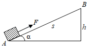

# Physics - 题目 363

**ID**: d33b1d75fb4d4f018084970873091447
**年级**: Grade 8
**难度**: Medium-Hard
**题型**: Fill-in-the-blank

## 题目
如图所示，斜面长s＝10m，高h＝4m。​​​​​​​‌现用沿斜面方向的推力F，将一个重为150N的木块由斜面底端A匀速推到顶端B，斜面的机械效率为75%，物体受到支持力是由于发生了弹性形变产生的，推力F大小为N。

## 解答

1. 物体放在斜面上，其受到的支持力属于弹力，施力物体是斜面，是由于斜面发生弹性形变而产生的。
2. 此过程所做有用功为
3. W_{有}＝Gh＝150N×4m＝600J
4. 由η＝ $\frac {W{{}_{有}}}{W{{}_{总}}}$ 得，总功为
5. W_{总}＝ $\frac {W{{}_{有}}}{η}$ ＝ $\frac {600{\rm{J}}}{75\%}$ ＝800J
6. 由W_{总}＝Fs得，拉力为
7. F＝ $\frac {W{{}_{总}}}{s}$ ＝ $\frac {800{\rm{J}}}{10m}$ ＝80N

## 知识点

**中文**:
  - 斜面的机械效率及其计算

**English**:
  - Mechanical Efficiency of Inclined Planes and Calculations

---
