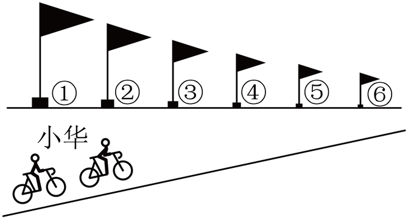

# Physics - 题目 2490

**ID**: ea501d4ed7bb432c83f499d56c460d92
**年级**: Grade 8
**难度**: Medium-Hard
**题型**: Fill-in-the-blank

## 题目
午后放学，小华骑车回家，在路上体验了一系列与运动有关的现象。​​​​​​​‌已知旗杆安装是有规范的，每根旗杆间的距离均为30米，如图所示。（1）小华在直行道上保持匀速骑行。经过①号旗杆时开始计时，到达④号旗杆时恰好用时5秒。求小华骑车的速度 $v{{}_{车}}$ （写出计算过程）；（2）在骑行过程中，小华以②号旗杆为参照物，则③号旗杆是的（选填“运动”或“静止”）；同时，他发现⑤号旗杆正在向后退，这是以为参照物的；（3）小华以一定的速度从①号旗杆向⑥号旗杆匀速骑行时，发现他车后座上的旗子的飘动方向与旗杆上旗子的飘动方向正好相反。由此可以判断出小华骑行的速度；

## 解答

1. （1）①号旗杆到④号旗杆的距离为 $s=3\times 30{\rm{m}}=90{\rm{m}}$ ，则小华骑车的速度为 $v{{}_{车}}=\frac {s}{t}=\frac {90{\rm{m}}}{5{\rm{s}}}=18{\rm{m}}/{\rm{s}}$ 。
2. （2）以②号旗杆为参照物，③号旗杆的相对位置不变，是静止的；以自行车为参照物，⑤号旗杆的相对位置改变，是正在向后运动的。
3. （3）如图，根据旗子的飘动方向可知风是从小华身后吹来的，小华在顺风行驶，但车后座上的旗子的飘动方向与旗杆上旗子的飘动方向正好相反，由此可以判断出小华骑行的速度一定大于风速，故选A。
4. （4）由此s-t图像可得，小华在8s内骑行120m，则速度为 $v=\frac {s}{t}=\frac {120{\rm{m}}}{8{\rm{s}}}=15{\rm{m}}/{\rm{s}}$ ，由此图像可知，小华骑行的路程和时间成正比，是在做匀速直线运动，设该骑行者的速度为 $v$ ，经过30秒后，他们两人之间的距离多了一根旗杆，即两人之间的距离由30m变为60m，若小华速度较大，则有 $\left ({15{\rm{m}}/{\rm{s}}-v}\right )\times 30{\rm{s}}=30{\rm{m}}+60{\rm{m}}$ ，解得 $v=12{\rm{m}}/{\rm{s}}$ ；若小华速度较小，则有 $\left ({v-15{\rm{m}}/{\rm{s}}}\right )\times 30{\rm{s}}=30{\rm{m}}$ ，解得 $v=16{\rm{m}}/{\rm{s}}$ ，所以该骑行者的速度可能为 $12{\rm{m}}/{\rm{s}}$ ，也可能为 $16{\rm{m}}/{\rm{s}}$ 。故选A。
5. （5）设小华速度为 $v{{}_{人}}$ ，风速为 $v{{}_{风}}$ ，从①号旗杆开始计时，到达⑥号旗杆，用时为t；接着，又从⑥号旗杆往回骑行，经过时间t，他恰好到达②号旗杆，则有 $\frac {5\times 30{\rm{m}}}{v{{}_{人}}+v{{}_{风}}}=\frac {4\times 30{\rm{m}}}{v{{}_{人}}-v{{}_{风}}}$     ①，又用时3秒，刚好回到①号旗杆，则有 $\left ({v{{}_{人}}-v{{}_{风}}}\right )\times 3{\rm{s}}=30{\rm{m}}$     ②，联立①②，解得风速 $v{{}_{风}}=1.25{\rm{m}}/{\rm{s}}$ 。

## 知识点

**中文**:
  - 运动和静止的相对性
  - 速度的图像问题
  - 速度的综合计算

**English**:
  - Relativity of Motion and Rest
  - Velocity-Time Graphs
  - Comprehensive Velocity Calculations

---
