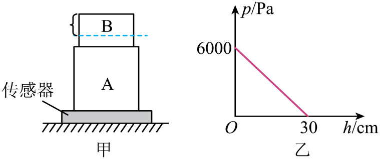

# Physics - 题目 1119

**ID**: fe87f72c71c54a479953e4277fb1e03b
**年级**: Grade 8
**难度**: Medium-Hard
**题型**: Fill-in-the-blank

## 题目
科学小组的小南发现了一个工艺品，由密度不同的均匀圆柱体A、B组成。​​​​​​​‌经测量，A、B的底面积分别为 ${\rm 250}{\rm{c}}{\rm{m}}{^{2}}$ 和 ${\rm 200}{\rm{c}}{\rm{m}}{^{2}}{\rm ，B}$ 高10cm。将其置于水平放置的传感器上，沿水平方向切割如图甲所示。传感器所受压强随切去高度h的变化图像如图乙所示。下列说法正确的是（      ）

## 解答

1. A．切割前A对传感器的压强为6000Pa，A对传感器的压力 $F^{′}=pS{{}_{A}}=6000{\rm{P}}{\rm{a}}\times 250\times 10{^{-4}}{\rm{m}}{^{{{2}}}}{\rm{=}}{{1}}{{5}}{{0}}{\rm{N}}$ ，故A错误；
2. B．由图像乙可知，当h=30cm时，传感器所受压强为0，则A、B的总高度为30cm，则A的高度 $h{{}_{{\rm{A}}}}=h-h{{}_{{\rm{B}}}}={{3}}{{0}}{\rm{c}}{\rm{m}}{{-}}{{1}}{{0}}{\rm{c}}{\rm{m}}{\rm{=}}{{2}}{{0}}{\rm{c}}{\rm{m}}$ ，由图像乙可知，传感器所受压随切去高度h的函数
3. $p=-200{\rm{P}}{\rm{a}}{\rm{/}}{\rm{c}}{\rm{m}}\times h+6000{\rm{P}}{\rm{a}}$ ，当B全部切去时，传感器所受压强 $p=-200{\rm{P}}{\rm{a}}{\rm{/}}{\rm{c}}{\rm{m}}\times h+6000{\rm{P}}a=-200{\rm{P}}{\rm{a}}{\rm{/}}{\rm{c}}{\rm{m}}\times 10{\rm{c}}{\rm{m}}+6000{\rm{P}}{\rm{a}}=4000{\rm{P}}{\rm{a}}$ ，根据 $p=\frac {F}{S}=\frac {G}{S}=\frac {ρgSh}{S}=ρgh$ ，可得，A的密度 $ρ{{}_{A}}=\frac {p}{gh{{}_{A}}}=\frac {{{4}}{{0}}{{0}}{{0}}{\rm{P}}{\rm{a}}}{{{1}}{{0}}{\rm{N}}{\rm{/}}{\rm{k}}{\rm{g}}\times {{0}}{{.}}{{2}}{\rm{m}}}=2\times 10{^{3}}{\rm{k}}{\rm{g}}{\rm{/}}{\rm{m}}{^{{{3}}}}=2{\rm{g}}{\rm{/}}{\rm{c}}{\rm{m}}{^{{{3}}}}$
4. 故B错误；
5. CD．A的重力 $G{{}_{A}}=m{{}_{A}}g=ρ{{}_{A}}gV{{}_{A}}=2\times 10{^{3}}{\rm{k}}{\rm{g}}{\rm{/}}{\rm{m}}{^{{{3}}}}\times 10{\rm{N}}{\rm{/}}{\rm{k}}{\rm{g}}\times 250\times 20\times 10{^{-6}}{\rm{m}}{^{{{3}}}}{\rm{=}}{{1}}{{0}}{{0}}{\rm{N}}{\rm ，B}$ 的重力
6. $G{{}_{{\rm{B}}}}=G{{}_{总}}-G{{}_{{\rm{A}}}}={{1}}{{5}}{{0}}{\rm{N}}{{-}}{{1}}{{0}}{{0}}{\rm{N}}{\rm{=}}{{5}}{{0}}{\rm{N}}$ ，当h=6cm时，B切去的重力 $G{{}_{B切}}=\frac {{{6}}{\rm{c}}{\rm{m}}}{{{1}}{{0}}{\rm{c}}{\rm{m}}}\times G{{}_{B}}=\frac {{{6}}{\rm{c}}{\rm{m}}}{{{1}}{{0}}{\rm{c}}{\rm{m}}}\times 50{\rm{N}}{\rm{=}}{{3}}{{0}}{\rm{N}}{\rm ，B}$ 剩余部分对A的压强 $p^{′}=\frac {F{{}_{剩B}}}{S{{}_{{\rm{B}}}}}=\frac {G{{}_{剩{\rm{B}}}}}{S{{}_{{\rm{B}}}}}=\frac {G{{}_{{\rm{B}}}}-G{{}_{切{\rm{B}}}}}{S{{}_{{\rm{B}}}}}=\frac {{{5}}{{0}}{\rm{N}}{{-}}{{3}}{{0}}{\rm{N}}}{200\times 10{^{-4}}m{^{2}}}=1000{\rm{P}}{\rm{a}}$ ，当h=6cm时，剩余样品与切割前的总重之比 $\frac {G{{}_{剩余}}}{G{{}_{总}}}=\frac {G{{}_{总}}-G{{}_{{\rm{B}}切}}}{G{{}_{总}}}=\frac {{{1}}{{5}}{{0}}{\rm{N}}{{-}}{{3}}{{0}}{\rm{N}}}{{{1}}{{5}}{{0}}{\rm{N}}}{\rm{=}}\frac {{{1}}{{2}}{{0}}{\rm{N}}}{{{1}}{{5}}{{0}}{\rm{N}}}{\rm{=}}\frac {{{4}}}{{{5}}}$ ，故C正确，D错误。

## 知识点

**中文**:
  - 压力的概念及其计算
  - 压强的计算

**English**:
  - Concept and Calculation of Pressure Force
  - Calculation of Pressure

---
