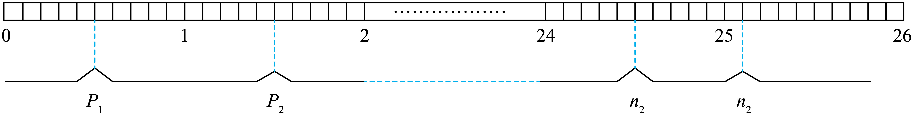

# Physics - 题目 2818

**ID**: 08f2c3d9dede462280a6f30acf787052
**年级**: Grade 8
**难度**: Medium-Hard
**题型**: Multiple-choice

## 题目
一艘装有声呐装置的军舰在海面上保持静止。​​​​​​​‌如图所示是声呐的示波器显示的声波信号发出与接收的情况。图中P_{1}、P_{2}是声呐发出的信号，n_{1}、n_{2}分别是P_{1}、P_{2}被不明物体反射回来的信号。若P_{1}、P_{2}之间的时间间隔Δt=1.0s，声波在海水中的传播速度v=1500m/s，下列说法正确的是（      ）

## 解答

1. 从图中可以看出，从信号P_{1}到接收到信号n_{1}经历的时间为24s，信号P_{1}遇到不明物体时，该物体到军舰的距离为
2. $s=vt=1500{\rm{m}}{\rm{/}}{\rm{s}}\times \frac {1}{2}\times 24{\rm{s}}=18000{\rm{m}}$
3. 从图中可以看出，从发出信号P_{2}到接收到信号n_{2}经历的时间为23.6s，信号P_{2}遇到不明物体时，该物体到军舰的距离为
4. $s{{}_{1}}=vt{{}_{1}}=1500{\rm{m}}{\rm{/}}{\rm{s}}\times \frac {1}{2}\times 23.6{\rm{s}}=17700{\rm{m}}$
5. 不明物体移动的距离为
6. $s{{}_{2}}=s-s{{}_{1}}=18000{\rm{m}}-17700{\rm{m}}=300{\rm{m}}$
7. 如图所示：
8. 
9. 第一列波单程运动的时间
10. $t{{}_{1}}=\frac {24{\rm{s}}}{2}=12{\rm{s}}$
11. 第二列波单程运动的时间
12. $t{{}_{2}}=\frac {23.6{\rm{s}}}{2}=11.8{\rm{s}}$
13. 当第一列波与不明物相遇时，第二列波因为晚发出1s，传播时间为
14. t_{1}-1s=11s
15. 因为不明物体和第二列波相向运动，剩下的问题就是相遇问题，相遇过程它们运动时间相等。因此不明物体移动这段距离的时间为
16. $t{{}_{3}}=t{{}_{2}}-\left ({t{{}_{1}}-1{\rm{s}}}\right )=11.8{\rm{s}}-11{\rm{s}}=0.8{\rm{s}}$
17. 所以不明物体移动的速度
18. $v{{}_{1}}=\frac {s{{}_{2}}}{t{{}_{3}}}=\frac {{{3}}{{0}}{{0}}{\rm{m}}}{0.8s}=375{\rm{m}}{\rm{/}}{\rm{s}}$
19. 综上所述，故ABC错误，D正确。

## 知识点

**中文**:
  - 速度的图像问题
  - 速度的综合计算

**English**:
  - Velocity-Time Graphs
  - Comprehensive Velocity Calculations

---
