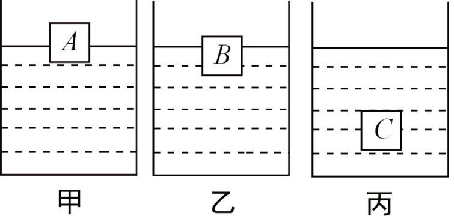

# Physics - 题目 1890

**ID**: 1773deb9e2994306af0d41d7bf63d616
**年级**: Grade 8
**难度**: Medium-Hard
**题型**: Multiple-choice

## 题目
如图所示，放在水平桌面上的三个完全相同的容器内，装有适量的水，将A、B、C三体积相同的正方体分别放入容器内，待正方体静止后，三个容器内水面高度相同。​​​​​​​‌下列说法正确的是（      ）

## 解答

1. 从图中可以看出，AB漂浮在水面上，C悬浮在水中，且ABC排开水的体积
2. $V{{}_{{\rm{A}}排}}<V{{}_{{\rm{B}}排}}<V{{}_{{\rm{C}}排}}$
3. A．由阿基米德原理得，物体受到的浮力大小关系为
4. $F{{}_{{\rm{A}}}}<F{{}_{{\rm{B}}}}<F{{}_{{\rm{C}}}}$
5. 故A错误；
6. B．根据浮沉条件与阿基米德原理得，物体排开水的重力等于物体的重力，因此三个容器内水和物体的总重力相等。容器放在水平桌面上，容器对桌面的压力等于容器、容器中的水、物体的总重力，三个容器相同，故三个容器对桌面的压力相等，由 $p=\frac {F}{S}$  得，容器对桌面的压强大小关系为
7. $p{{}_{甲}}=p{{}_{乙}}=p{{}_{丙}}$
8. 故B正确；
9. C．待正方体静止后，三个容器内水面高度相同，即容器中水的深度相同，由 $p=ρgh$  得，容器底部受到水的压强大小关系为
10. $p{{}_{甲}}=p{{}_{乙}}=p{{}_{丙}}$
11. 故C错误；
12. D．由浮沉条件得，物体的重力等于物体受到的浮力，物体受到的浮力大小关系为
13. $F{{}_{{\rm{A}}}}<F{{}_{{\rm{B}}}}<F{{}_{{\rm{C}}}}$
14. 因此物体受到的重力大小关系为
15. $G{{}_{{\rm{A}}}}<G{{}_{{\rm{B}}}}<G{{}_{{\rm{C}}}}$
16. 由 $G=mg$  得，物体的质量大小关系为
17. $m{{}_{{\rm{A}}}}<m{{}_{{\rm{B}}}}<m{{}_{{\rm{C}}}}$
18. 由 $ρ=\frac {m}{V}$  得，三个物体的密度大小关系为
19. $ρ{{}_{{\rm{A}}}}<ρ{{}_{{\rm{B}}}}<ρ{{}_{{\rm{C}}}}$
20. 故D错误。
21. 故选B。

## 知识点

**中文**:
  - 实验探究物体的浮沉条件

**English**:
  - Experiment: Investigating Floating/Sinking Conditions

---
