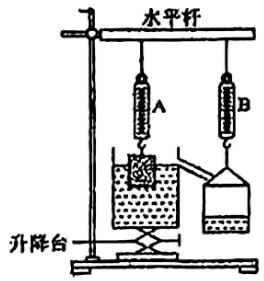

# Physics - 题目 536

**ID**: 20188623461b4d14802aad56da6b2118
**年级**: Grade 8
**难度**: Medium-Hard
**题型**: Multiple-choice

## 题目
小强用如图所示的实验装置验证阿基米德原理，通过调节升降台让金属块浸入盛满水的溢水杯中（金属块始终未与容器底接触），溢出的水会流入右侧空桶中，下列说法正确的是（      ）​​​​​​​‌

## 解答

1. A．若实验前溢水杯中未装满水，则测得的F_{浮}不变、G_{排}偏小，对实验结果有影响故A错误；
2. B．金属块浸没在水中的深度变化时，排开水的体积不变，根据F_{浮}=ρgV_{排}可知，受到的浮力不变，根据F_{拉}=G_{金}-F_{浮}知，金属块受到的拉力不变，弹簧测力计A的示数不变故B错误；
3. C．金属块浸入水中的深度增大时，溢水杯中水的深度不变，根据p=ρgh可知，水对溢水杯底部的压强不变，根据F=pS可知，水对溢水杯底部的压力不变故C错误；
4. D．由图可知，弹簧测力计A的示数F_{A}=G-F_{浮}，弹簧测力计B的示数F_{B}=G_{桶}+G_{排}，则∆F_{A}=∆F_{浮}，∆F_{B}=∆G_{排}，根据阿基米德原理可知∆F_{浮}=∆G_{排}，则∆F_{A}=∆F_{B}故D正确。

## 知识点

**中文**:
  - 液体压强计算公式的应用
  - 阿基米德原理的应用

**English**:
  - Application of Liquid Pressure Formula
  - Applications of Archimedes' Principle

---
