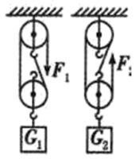

# Physics - 题目 472

**ID**: 3d7acf16280b4202a66b043da9c07bb2
**年级**: Grade 8
**难度**: Medium-Hard
**题型**: Multiple-choice

## 题目
如图所示，小明用两个滑轮组（绳重和摩擦不计，动滑轮重相同），分别将重力不同的两个物体匀速提升到相同高度，其中G_{1}＞G_{2}， 则下列判断正确的是​​​​​​​‌

## 解答

1. (1)由如可知,n＝2,绳重及摩擦不计,由F＝ $\frac {1}{n}$ （G+G_{动}）可知,G_{l}>G_{2}时,F_{l}>F_{2}，故AB错误；(2)由η＝ $\frac {W{{}_{有}}}{W{{}_{总}}}$ ×100%＝ $\frac {{\rm{G}}{\rm{h}}}{\left ({{\rm{G}}+{\rm{G}}{{}_{动}}}\right ){\rm{h}}}$ ×100%＝ $\frac {{\rm{G}}}{{\rm{G}}+{\rm{G}}{{}_{动}}}$ ×100%＝ $\frac {1}{1+\frac {{\rm{G}}{{}_{动}}}{{\rm{G}}}}$ ×100%可知,G_{l}>G_{2}时,η_{l}>η_{2}，故C正确、D错误．故选C.
2. 【点睛】
3. （1）由如可知滑轮组绳子的有效股数，绳重及摩擦不计，根据F＝ $\frac {1}{n}$ （G+G_{动}）比较两种情况下拉力的关系；（2）有用功为克服物体重力所做的功，总功为克服物体重力和动滑轮重力所做的功，根据η＝ $\frac {W{{}_{有}}}{W{{}_{总}}}$ ×100%＝ $\frac {{\rm{G}}{\rm{h}}}{\left ({{\rm{G}}+{\rm{G}}{{}_{动}}}\right ){\rm{h}}}$ ×100%＝ $\frac {{\rm{G}}}{{\rm{G}}+{\rm{G}}{{}_{动}}}$ ×100%＝ $\frac {1}{1+\frac {{\rm{G}}{{}_{动}}}{{\rm{G}}}}$ ×100%比较两种情况下机械效率的关系．

## 知识点

**中文**:
  - 滑轮组绳子拉力的计算
  - 滑轮（组）的机械效率及其计算

**English**:
  - Calculating Rope Tension in Pulley Systems
  - Mechanical Efficiency of Pulleys and Calculations

---
