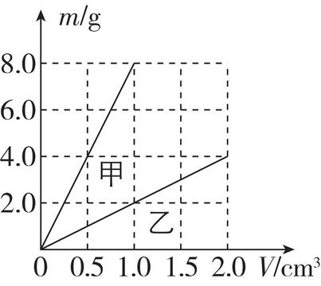

# Physics - 题目 1839

**ID**: 3fc7a8831fd641a792868fea82e452e7
**年级**: Grade 8
**难度**: Medium-Hard
**题型**: Multiple-choice

## 题目
如图是甲、乙两种物质的质量和体积的关系图像， $A$ 和 $B$ 分别是由甲、乙两种物质构成的两个均匀实心正方体，当 $A$ 、 $B$ 静止在水平地面上时，对水平地面的压强之比为 $8:1$ ，则 $A$ 的高度与 $B$ 的高度之比是（      ）​​​​​​​‌

## 解答

1. 由图可知，当乙物质的质量为 $4.0\mathrm{ }\mathrm{g}$ 时，体积为 $2.0\mathrm{ }{\mathrm{c}\mathrm{m}}^{3}$ ，乙物质的密度 ${\rho }_{乙}=\frac{{m}_{乙}}{{V}_{乙}}=\frac{4.0\mathrm{ }\mathrm{g}}{2.0\mathrm{ }\mathrm{ }{\mathrm{c}\mathrm{m}}^{3}}=2.0\mathrm{ }\mathrm{g}/{\mathrm{c}\mathrm{m}}^{3}$ ，当甲物质的质量为 $8.0\mathrm{ }\mathrm{g}$ 时，体积为 $1.0\mathrm{ }{\mathrm{c}\mathrm{m}}^{3}$ ，甲物质的密度  ${\rho }_{甲}=\frac{{m}_{甲}}{{V}_{甲}}=\frac{8.0\mathrm{ }\mathrm{g}}{1.0\mathrm{ }\mathrm{ }{\mathrm{c}\mathrm{m}}^{3}}=8.0\mathrm{ }\mathrm{g}/{\mathrm{c}\mathrm{m}}^{3}$ ，所以A、B的密度之比为 $\frac{{\rho }_{A}}{{\rho }_{B}}=\frac{{\rho }_{甲}}{{\rho }_{乙}}=\frac{8.0\mathrm{ }\mathrm{g}/{\mathrm{c}\mathrm{m}}^{3}}{2.0\mathrm{ }\mathrm{g}/{\mathrm{c}\mathrm{m}}^{3}}=\frac{4}{1}$ ，而当正方体静止在水平地面上时，对水平地面的压强 $p=\frac{F}{S}=\frac{mg}{S}=\frac{\rho Vg}{S}=\frac{\rho Shg}{S}=\rho hg{\rm ，A}$ 、B的高度之比为 $\frac{{h}_{A}}{{h}_{B}}=\frac{\frac{{p}_{A}}{{\rho }_{A}g}\mathrm{ }}{\frac{{p}_{B}}{{\rho }_{B}g}\mathrm{ }}=\frac{{p}_{A}}{{p}_{B}}×\frac{{\rho }_{B}}{{\rho }_{A}}=\frac{8}{1}×\frac{1}{4}=\frac{2}{1}$ ，即 $2:1$ ，故选B。

## 知识点

**中文**:
  - 固体压强的判断与计算

**English**:
  - Determination and Calculation of Solid Pressure

---
