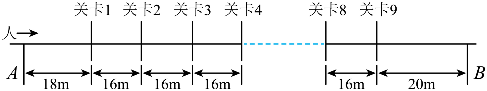

# Physics - 题目 1857

**ID**: 4798407adc9a420383ecb955b7d2b92e
**年级**: Grade 8
**难度**: Medium-Hard
**题型**: Multiple-choice

## 题目
某“闯关游戏”在笔直通道上每隔16m设有一个关卡，总共9个关卡（如图所示）各关卡同步放行和关闭，关卡放行时间为5s，关闭时间为2s，小海站在关卡1左侧18m远的A处，当关卡刚好放行时，他以4m/s的速度从A处匀速跑向关卡。​​​​​​​‌之后，他从关卡5开始以5m/s的速度匀速通过剩下关卡到达距关卡9有20m的终点B。下列说法正确的是（      ）

## 解答

1. 各关卡同步放行和关闭，关卡放行时间为5s，关闭时间为2s，因此第一个关闭时间为第6s、第7s，第二个关闭时间为第13s、第14s，第三个关闭时间为第20s、第21s，以此类推；第四个关闭时间为第27s、第28s，第五个关闭时间为第34s、第35s，第六个关闭时间为第41s、第42s；
2. AB．小海到达第一个关卡用的时间
3. $t{{}_{1}}=\frac {s{{}_{1}}}{v}=\frac {18{\rm m}}{4{\rm m}/{\rm s}}=4.5{\rm s}$
4. 关卡放行时间为5s，因此第一个关卡能顺利通过，以后以4m/s的速度美走过16m所用的时间
5. $t=\frac {s}{v}=\frac {16{\rm m}}{4{\rm m}/{\rm s}}=4s$
6. 到达第二个关卡的时间为8.5s，由推理可知，能顺利通过，到达第三个关卡所用时间为12.5s，此时关卡闭合不能通过，需等待1.5s，到达第四个关卡的时间为18s，能顺利通过，到达第五个关卡的时间为22s，能顺利通过。18s时小海在关卡4，小海与A处之间的距离为
7. $s{{}_{4}}=18{\rm m}+3\times 16{\rm m}=66{\rm m}$
8. 故AB错误；
9. CD．他从关卡5开始以5m/s的速度匀速通过剩下关卡，走完每个关卡所用的时间
10. $t^{′}=\frac {s}{v^{′}}=\frac {16{\rm m}}{5{\rm m}/{\rm s}}=3.2{\rm s}$
11. 小海到达关卡6，所用的时间为
12. $t{{}_{6}}=22{\rm s}+3.2{\rm s}=25.2{\rm s}$
13. 不在关闭时间能顺利通过，小海到达关卡7，所用的时间为
14. $t{{}_{7}}=25.2{\rm s}+3.2{\rm s}=28.4{\rm s}$
15. 不在关闭时间能顺利通过，小海到达关卡8，所用的时间为
16. $t{{}_{7}}=28.4{\rm s}+3.2{\rm s}=31.6{\rm s}$
17. 不在关闭时间能顺利通过，小海到达关卡9，所用的时间为
18. $t{{}_{9}}=31.6{\rm s}+3.2{\rm s}=34.8{\rm s}$
19. 在关卡关闭时间，需等待0.2s，小海从A到达关卡9所用的时间为35s被挡住两次，小海从A到达终点B所用的时间为
20. $t{{}_{总}}=t{{}_{9}}+\frac {s^{′}}{v^{′}}=35{\rm s}+\frac {20{\rm m}}{5{\rm m}/{\rm s}}=39{\rm s}$
21. 由以上分析可知，C错误，D正确。
22. 故选D。

## 知识点

**中文**:
  - 速度的综合计算

**English**:
  - Comprehensive Velocity Calculations

---
