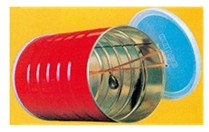

# Physics - 题目 1260

**ID**: 4f2184852c764f4d868e11108d2053ac
**年级**: Grade 8
**难度**: Medium-Hard
**题型**: Multiple-choice

## 题目
如图所示，在一个罐子的盖和底各开两个小洞，将小铁块用细绳绑在橡皮筋的中部穿入罐中，橡皮筋两端穿过小洞用竹签固定，做好后使它从不太陡的斜面滚下。​​​​​​​‌下列说法正确的是（      ）

## 解答

1. A．铁罐从不太陡的斜面上滚下，是从最高处滚下，铁罐先由慢到快、后由快到慢滚到最低点，上面一段滚动主要是重力势能减小，铁罐的动能和橡皮筋的弹性势能增加；下面一段滚动主要是重力势能和铁罐的动能减小，橡皮筋的弹性势能增加，故A错误；
2. B．在橡皮筋恢复的过程中，铁罐会由斜面底部自动滚上去，从最低处向上滚时，铁罐先由慢到快、后由快到慢滚到最高点，下面一段向上滚动主要是橡皮筋的弹性势能减小，铁罐的动能和重力势能增加；上面一段滚动主要是橡皮筋的弹性势能和铁罐的动能减小，重力势能增加，故B正确；
3. C．铁罐在斜面上滚到最低处时，橡皮筋形变到最大程度，具有较大弹性势能，故C错误；
4. D．在相互转化的过程中要克服阻力做功，机械能不守恒，总有一部分机械能转化为内能散失到空气中，最后罐子的机械能全部转化为其它形式的能量而停止运动，故D错误。
5. 故选B。

## 知识点

**中文**:
  - 动能和势能的转化
  - 动能的变化问题
  - 弹性势能的变化问题

**English**:
  - Transformation between Kinetic and Potential Energy
  - Changes in Kinetic Energy
  - Changes in Elastic Potential Energy

---
