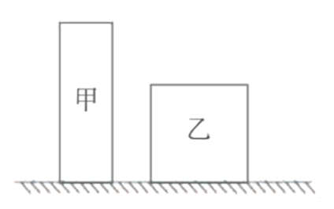

# Physics - 题目 1823

**ID**: 5a026351b4a0443a90f0b45622755c35
**年级**: Grade 8
**难度**: Medium-Hard
**题型**: Multiple-choice

## 题目
如图所示，甲、乙（ $S{{}_{甲}}<S{{}_{乙}}$ ， $h{{}_{甲}}>h{{}_{乙}}$ ）两个均匀实心圆柱体放在水平地面上。​​​​​​​‌若在它们上部分别水平切去 $\Delta h{{}_{甲}}$ 、 $\Delta h{{}_{乙}}$ 后，甲和乙剩余部分的质量恰好相等。若 $\Delta h{{}_{甲}}=\Delta h{{}_{乙}}$ ，则 $\Delta m{{}_{甲}}$$\Delta m{{}_{乙}}$ （选填“>”“=”“<”），若 $\Delta h{{}_{甲}}<\Delta h{{}_{乙}}$ ，则 $\Delta m{{}_{甲}}$$\Delta m{{}_{乙}}$ （选填“>”“=”“<”）。

## 解答

1. 甲乙切去部分的质量分别为 $\Delta m{{}_{甲}}=ρ{{}_{甲}}\Delta h{{}_{甲}}S{{}_{甲}}$ ， $\Delta m{{}_{乙}}=ρ{{}_{乙}}\Delta h{{}_{乙}}S{{}_{乙}}$ ，故 $\frac {\Delta m{{}_{甲}}}{\Delta m{{}_{乙}}}=\frac {ρ{{}_{甲}}\Delta h{{}_{甲}}S{{}_{甲}}}{ρ{{}_{乙}}\Delta h{{}_{乙}}S{{}_{乙}}}$ ，甲乙剩余部分的质量分别为 $m{{}_{甲剩}}=ρ{{}_{甲}}\left ({h{{}_{甲}}-{\rm{Δ}}h{{}_{甲}}}\right )S{{}_{甲}}$ ， $m{{}_{乙剩}}=ρ{{}_{乙}}\left ({h{{}_{乙}}-{\rm{Δ}}h{{}_{乙}}}\right )S{{}_{乙}}$ ，根据甲剩余质量相等可得 $ρ{{}_{甲}}\left ({h{{}_{甲}}-{\rm{Δ}}h{{}_{甲}}}\right )S{{}_{甲}}=ρ{{}_{乙}}\left ({h{{}_{乙}}-{\rm{Δ}}h{{}_{乙}}}\right )S{{}_{乙}}$ ，故 $\frac {h{{}_{甲}}-\Delta h{{}_{甲}}}{h{{}_{乙}}-\Delta h{{}_{乙}}}=\frac {ρ{{}_{乙}}S{{}_{乙}}}{ρ{{}_{甲}}S{{}_{甲}}}$ ，因为 $h{{}_{甲}}>h{{}_{乙}}$ ，若 $\Delta h{{}_{甲}}=\Delta h{{}_{乙}}$ ，则 $h{{}_{甲}}-\Delta h{{}_{甲}}>h{{}_{乙}}-\Delta h{{}_{乙}}$ ，则 $h{{}_{乙}}S{{}_{乙}}>h{{}_{甲}}S{{}_{甲}}$ ，故 $\Delta m{{}_{甲}}<\Delta m{{}_{乙}}$ 。若 $\Delta h{{}_{甲}}<\Delta h{{}_{乙}}$ ，则 $h{{}_{甲}}-\Delta h{{}_{甲}}>h{{}_{乙}}-\Delta h{{}_{乙}}$ ，则 $h{{}_{乙}}S{{}_{乙}}>h{{}_{甲}}S{{}_{甲}}$ ，故 $\Delta m{{}_{甲}}<\Delta m{{}_{乙}}$ 。

## 知识点

**中文**:
  - 固体压强的判断与计算

**English**:
  - Determination and Calculation of Solid Pressure

---
