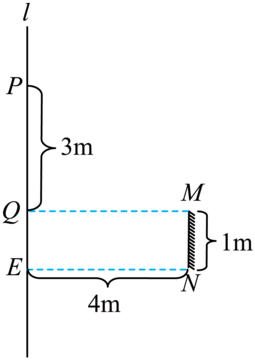

# Physics - 题目 2307

**ID**: 5a18dfb243d645f3ab62a5952d84ead4
**年级**: Grade 8
**难度**: Medium-Hard
**题型**: Multiple-choice

## 题目
如图，竖直平面镜$MN$与直线$l$平行，人眼位于$P$点，其中$P、Q、E$均为直线$l$上的点，$PQ$长为3 m，$QE=MN=1{\rm{m}}$，$QM=EN=4{\rm{m}}$，点光源${\rm{S}}$在直线$l$上且在$E$点以下的某区域内自由移动（图中未画出），此人恰好都能通过平面镜看见${\rm{S}}$的像，则点光源${\rm{S}}$移动的最大长度是（      ）​​​​​​​‌

## 解答

1. 如图，以E点为原点建立平面直角坐标系，则各点位置如图所示，连接MP、NP，根据光的反射定律，作出MP的入射光线AM，作出NP的入射光线BN，则AB即为点光源 ${\rm{S}}$ 移动的范围，则点光源 ${\rm{S}}$ 移动的最大长度为 $l=AB=2{\rm{m}}$
2. 
3. 故ACD不符合题意，B符合题意。

## 知识点

**中文**:
  - 光的反射定律及其应用
  - 平面镜成像的特点、原理及现象

**English**:
  - Law of Reflection and Applications
  - Characteristics, Principles, and Phenomena

---
