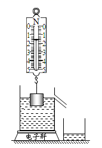

# Physics - 题目 1440

**ID**: 6062c75792ee4480be18ccad47ac1225
**年级**: Grade 8
**难度**: Medium-Hard
**题型**: Multiple-choice

## 题目
如图所示，水平桌面上放置一个电子秤，电子秤上有一盛水的溢水杯，杯内水面跟溢水口相平。​​​​​​​‌现用弹簧测力计悬挂一个圆柱体铝块，将铝块缓缓地浸入水中，直到铝块完全浸没在水中为止，整个过程铝块未接触杯底和侧壁。则从铝块下表面开始接触水面到上表面刚没入水中的过程中（      ）

## 解答

1. 根据阿基米德原理可知，浸入液体中的物体受到的浮力的大小等于其排开的液体受到的重力，将铝块缓缓地浸入水中，直到铝块完全浸没在水中为止，整个过程铝块未接触杯底和侧壁，排开水的体积先变大后不变，由阿基米德原理可知从铝块下表面开始接触水面到上表面刚没入水中的过程中受到的浮力变大，根据
2. F=G-F_{浮}
3. 可得测力计的示数变小；由于溢水杯中装满水，铝块浸没在水中静止时，根据阿基米德原理可知铝块受到的浮力等于排开的水重，铝块对水的压力大小与浮力相等，根据力的作用是相互的，铝块给杯底一个压力，大小等于浮力所以溢水杯对电子秤的压力不变，即电子秤示数不变。
4. 故选B。

## 知识点

**中文**:
  - 压力大小的比较
  - 浮力大小的计算
  - 阿基米德原理的应用

**English**:
  - Comparing Magnitude of Pressure Force
  - Calculation of Buoyancy
  - Applications of Archimedes' Principle

---
