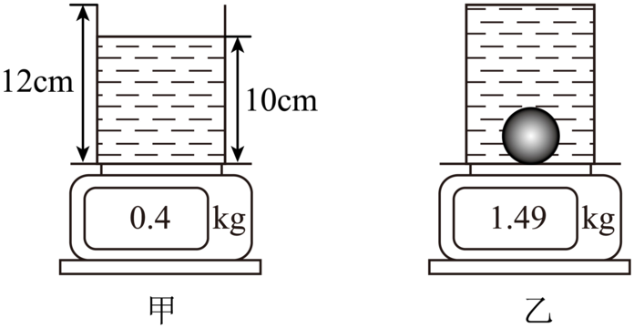

# Physics - 题目 196

**ID**: 66c266f17ad54e5689b559a685d1e912
**年级**: Grade 8
**难度**: Medium-Hard
**题型**: Multiple-choice

## 题目
底面积为50cm^{2}、高为12cm的薄壁圆柱形容器（质量忽略不计），里面装有一定量的液体，液面高度为10cm，将其放于电子秤上，示数如图甲所示。​​​​​​​‌现将一质量为1.17kg的不吸水金属球轻轻放入杯中沉底后，发现有液体溢出杯口，待液面稳定后将容器外壁的液体擦干再平稳地放在电子秤上，其示数如图乙所示。若该金属球空心部分注满水，则其总质量为1.22kg，则下列说法正确的是（      ）

## 解答

1. ABC．由图甲可知，液体的体积为 $V{{}_{甲液}}{\rm{=}}50{\rm{c}}{\rm{m}}{^{2}}\times 10{\rm{c}}{\rm{m}}{\rm{=}}500{\rm{c}}{\rm{m}}{^{3}}$
2. 则液体的密度为 $ρ{{}_{液}}=\frac {m{{}_{甲液}}}{V{{}_{甲液}}}=\frac {{{0}}{{.}}{{4}}{\rm{k}}{\rm{g}}}{{{5}}{{0}}{{0}}\times {{1}}{{0}}{^{{{-}}{{6}}}}{\rm{m}}{^{{{3}}}}}{\rm{=}}{{0}}{{.}}{{8}}\times {{1}}{{0}}{^{{{3}}}}{\rm{k}}{\rm{g}}{\rm{/}}{\rm{m}}{^{{{3}}}}$
3. 由图乙可知，溢出液体的质量为 $m{{}_{溢}}{\rm{=}}{{1}}{{.}}{{1}}{{7}}{\rm{k}}{\rm{g}}{{+}}{{0}}{{.}}{{4}}{\rm{k}}{\rm{g}}{{-}}{{1}}{{.}}{{4}}{{9}}{\rm{k}}{\rm{g}}{\rm{=}}{{0}}{{.}}{{0}}{{8}}{\rm{k}}{\rm{g}}$
4. 则溢出液体的体积为 $V{{}_{溢}}{\rm{=}}\frac {m{{}_{溢}}}{ρ{{}_{液}}}{\rm{=}}\frac {{{0}}{{.}}{{0}}{{8}}{\rm{k}}{\rm{g}}}{0.8\times {{1}}{{0}}{^{{{3}}}}{\rm{k}}{\rm{g}}{\rm{/}}{\rm{m}}{^{{{3}}}}}{\rm{=}}{{1}}{{0}}{{0}}{\rm{c}}{\rm{m}}{^{3}}$
5. 则金属球排开液体的体积为 $V{{}_{排}}{\rm{=}}{{1}}{{0}}{{0}}{\rm{c}}{\rm{m}}{^{{{3}}}}{{+}}{{5}}{{0}}{\rm{c}}{\rm{m}}{^{{{2}}}}\times {\rm{(}}{{1}}{{2}}{\rm{c}}{\rm{m}}{{-}}{{1}}{{0}}{\rm{c}}{\rm{m}}{\rm{)}}{\rm{=}}{{2}}{{0}}{{0}}{\rm{c}}{\rm{m}}{^{{{3}}}}$
6. 即金属球的体积为 $V{{}_{金属球}}{\rm{=}}V{{}_{排}}{\rm{=}}{{2}}{{0}}{{0}}{\rm{c}}{\rm{m}}{^{{{3}}}}$
7. 图乙中液体的体积为 $V{{}_{乙液}}{\rm{=}}V{{}_{容}}{{-}}V{{}_{金属球}}{\rm{=}}50{\rm{c}}{\rm{m}}{^{2}}\times 12{\rm{c}}{\rm{m}}{{-}}200{\rm{c}}{\rm{m}}{^{3}}{\rm{=}}400{\rm{c}}{\rm{m}}{^{3}}$
8. 故A正确，BC错误；
9. D．根据 $ρ{\rm{=}}\frac {m}{V}$ 可得，该金属球注满水后的平均密度是 $ρ^{′}{{\rm{=}}}\frac {m^{′}}{V{{}_{金属球}}}=\frac {{{1}}{{.}}{{2}}{{2}}{\rm{k}}{\rm{g}}}{{{2}}{{0}}{{0}}{\rm{c}}{\rm{m}}{^{{{3}}}}}{\rm{=}}{{6}}{{.}}{{1}}\times {{1}}{{0}}{^{{{3}}}}{\rm{k}}{\rm{g}}{\rm{/}}{\rm{m}}{^{{{3}}}}$
10. 故D错误。

## 知识点

**中文**:
  - 密度综合计算

**English**:
  - Comprehensive Density Calculations

---
