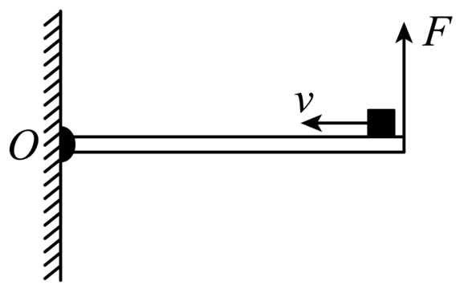

# Physics - 题目 1412

**ID**: 697c80fae8824baeb39e8569402aa2e1
**年级**: Grade 8
**难度**: Medium-Hard
**题型**: Multiple-choice

## 题目
如图，长为L的轻质木板（不计质量），左端可绕O点转动，右端放一重为G的小物块，用竖直向上的力F拉着木板的右端，使木板始终在水平位置保持静止。​​​​​​​‌小物块向左匀速滑行过程中，下图能正确表示拉力F与小物块运动时间t关系的是（      ）

## 解答

1. 如图所示
2. 
3. 动力臂为OA=L，杠杆受到物体的压力（阻力）F_{压}=G，阻力臂为OB，物块向左做匀速滑动，则阻力臂
4. OB=OA-vt=L-vt
5. 因杠杆平衡，根据杠杆的平衡条件得
6. F×OA=F_{压}×OB=G×(OA-vt)
7. 即
8. F×L=G×(L-vt)
9. 解得
10. $F=G-\frac {vG}{L}t$
11. 因G、v、L为常数，所以拉力F与运动时间t是一次函数关系，当t增大时，F减小，变化关系为直线，故A符合题意，BCD不符合题意。
12. 故选A。

## 知识点

**中文**:
  - 杠杆的动态平衡分析

**English**:
  - Dynamic Equilibrium Analysis of Levers

---
