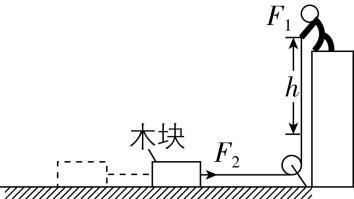

# Physics - 题目 2499

**ID**: 6cda33742144492b91a717dff8093370
**年级**: Grade 8
**难度**: Medium-Hard
**题型**: Multiple-choice

## 题目
如图所示，小明通过定滑轮将一木块沿水平方向匀速拉动一段距离，小明对绳子自由端竖直向上的拉力为 ${F}_{1}$ ，绳子自由端上升的距离为 $h$ 。​​​​​​​‌绳子对木块水平方向的拉力为 ${F}_{2}$ ，木块的重力为 $G$ ，已知 ${F}_{1}>{F}_{2}$ ，以下说法正确的是（      ）

## 解答

1. 因为 ${F}_{1}>{F}_{2}$ ，所以小明使用定滑轮不能省力，故 $\mathrm{A}$ 错误；使用定滑轮拉木块时，木块在水平方向运动，所以有用功是克服摩擦力做的功，因为木块做匀速运动，所以木块受到的摩擦力与拉力大小相等，则克服摩擦力做的功等于拉力 ${F}_{2}$ 做的功，即 ${W}_{有}={F}_{2}h$ ，故 $\mathrm{B}$ 错误；使用定滑轮拉木块时，总功是拉力 ${F}_{1}$ 做的功，绳子自由端上升的距离为 $h$ ，所以总功 ${W}_{总}={F}_{1}h$ ，故 $\mathrm{C}$ 正确；定滑轮的机械效率 $\eta =\frac{{W}_{有}}{{W}_{总}}=\frac{{F}_{2}h}{{F}_{1}h}=\frac{{F}_{2}}{{F}_{1}}$ ，故 $\mathrm{D}$ 错误。故选 $\mathrm{C}$ 。

## 知识点

**中文**:
  - 定滑轮及其工作特点
  - 有用功、额外功和总功的计算
  - 滑轮（组）的机械效率及其计算

**English**:
  - Fixed Pulleys and Operating Characteristics
  - Calculation of Useful, Extra, and Total Work
  - Mechanical Efficiency of Pulleys and Calculations

---
