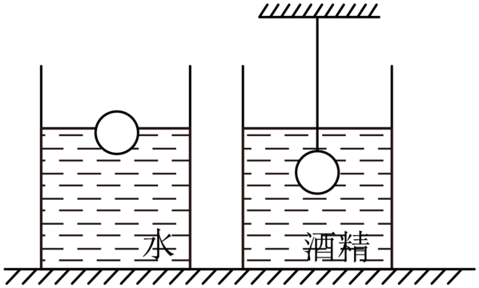

# Physics - 题目 1024

**ID**: 72cc021cd47c4c51bbf7b3d6d7a3896b
**年级**: Grade 8
**难度**: Medium-Hard
**题型**: Multiple-choice

## 题目
如图所示，水平桌面上放有甲、乙两个完全相同的圆柱形容器。​​​​​​​‌甲容器内盛有水，水面上漂浮着一个木球；乙容器内用细线悬吊着一个实心的铝球浸没在酒精中。此时，两个容器中的液面一样高。已知木球和铝球的体积相同， $ρ{{}_{铝}}=2.7\times 10{^{3}}{\rm kg}$ / ${\rm m}{^{3}}$ ， $ρ{{}_{木}}=0.6\times 10{^{3}}{\rm kg}$ / ${\rm m}{^{3}}$ ， $ρ{{}_{酒精}}=0.8\times 10{^{3}}{\rm kg}$ / ${\rm m}{^{3}}$ ， $ρ{{}_{水}}=1\times 10{^{3}}{\rm{k}}{\rm{g}}/{\rm{m}}{^{3}}$ 。则下列说法中正确的是（      ）

## 解答

1. 水的密度大于酒精的密度，二者到容器底的深度相同，根据 $p=ρgh$ 可知，水对容器底的压强大于酒精对容器底的压强。两个容器是圆柱形的，它们对桌面的压力等于液体对容器底的压力加上容器的重力。两个容器完全相同：重力相同，底面积相同。而据 $F=pS$ 可知水对容器底的压力大于酒精对容器底的压力，故甲容器对桌面的压力大于乙容器对桌面的压力，故AB错误；木球漂浮，受到的浮力与自身的重力相等，有 $G=F{{}_{浮1}}$ ，即 $ρ{{}_{木}}gV{{}_{木}}=ρ{{}_{水}}gV{{}_{排水}}$ ，有 $0.6\times 10{^{3}}{\rm{k}}{\rm{g}}/{\rm{m}}{^{3}}\times g\times V{{}_{木}}=1\times 10{^{3}}{\rm{k}}{\rm{g}}/{\rm{m}}{^{3}}\times g\times V{{}_{排水}}$ ，得 $V{{}_{排水}}=\frac {3}{5}V{{}_{木}}$ ，
2. 木球和铝球的体积相等，则木球与铝球受到的浮力之比为 $\frac {F{{}_{浮1}}}{F{{}_{浮2}}}=\frac {ρ{{}_{水}}gV{{}_{排水}}}{ρ{{}_{酒}}gV{{}_{排酒}}}=\frac {ρ{{}_{水}}g\times \frac {3}{5}V{{}_{木}}}{ρ{{}_{酒}}gV{{}_{铝}}}=\frac {3}{4}$ ，因为木球和铝球受到的浮力之比小于1，说明木球受到的浮力小于铝球受到的浮力，将物体浸入容器液体中，物体受到一个向上的浮力，同时液面上升了，对容器底的压强增大了，对容器底的压力也增大了，浮力的相互作用力表现为液体对容器底部增大的压力。木球受到的浮力小于铝球受到的浮力，将二者取出后，液体对容器底的压力都减小了，但水对容器底的压力减小得小，酒精对容器底的压力减小得大。原来水对容器底的压力大于酒精对容器底的压力。故将二者取出后，水对容器底的压力大于酒精对容器底的压力，圆柱形容器放在水平面上，对水面的压力等于容器的重力与里面液体对容器底压力的和，故将两个小球取出后，甲容器对水平面的压力，两个容器的底面积相等，所以甲容器对水平桌面的压强大，D错误。

## 知识点

**中文**:
  - 密度、压强和浮力的综合

**English**:
  - Integrated Density, Pressure, and Buoyancy

---
