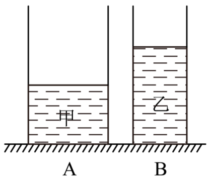

# Physics - 题目 2361

**ID**: 77b30e9ca17e417ebc595ab5d6088e6e
**年级**: Grade 8
**难度**: Medium-Hard
**题型**: Multiple-choice

## 题目
如图所示，两个足够高的薄壁轻质圆柱形容器A、B（底面积 $S{{}_{{\rm{A}}}}>S{{}_{{\rm{B}}}}$ ）置于水平地面上，容器中分别盛有体积相等的液体甲和乙，它们对各自容器底部的压强相等。​​​​​​​‌下列选项中，能使甲液体对容器底部压强大于乙液体对容器底部压强的操作方法是（      ）

## 解答

1. 根据题意，由压强公式 $p=\frac {F}{S}$ 可知，
2. $F{{}_{{\rm{A}}}}{\rm{=}}p{{}_{{\rm{A}}}}S{{}_{{\rm{A}}}}$ ， $F{{}_{{\rm{B}}}}{\rm{=}}p{{}_{{\rm{B}}}}S{{}_{{\rm{B}}}}$
3. 由 $p{{}_{{\rm{A}}}}=p{{}_{{\rm{B}}}}$ ， $S{{}_{{\rm{A}}}}>S{{}_{{\rm{B}}}}$ ，故
4. $F{{}_{{\rm{A}}}}{\rm{>}}F{{}_{{\rm{B}}}}$
5. 由柱形容器液体对底部的压力等于液体的重力，即
6. $G{{}_{甲}}{\rm{>}}G{{}_{乙}}$
7. 由 $G=mg$ 可得
8. $m{{}_{甲}}{\rm{>}}m{{}_{乙}}$
9. 由于两种液体的体积相同，根据密度公式 $ρ=\frac {m}{V}$ 可知
10. $ρ{{}_{甲}}{\rm{>}}ρ{{}_{乙}}$
11. A．分别倒入相同深度的液体甲和乙，则甲和乙分别增加的压强为
12. $\Delta p{{}_{{\rm{A}}}}=ρ{{}_{甲}}gh$ ， $\Delta p{{}_{{\rm{B}}}}=ρ{{}_{乙}}gh$
13. 由 $ρ{{}_{甲}}{\rm{>}}ρ{{}_{乙}}$ ，则 $\Delta p{{}_{{\rm{A}}}}>\Delta p{{}_{{\rm{B}}}}$ ，原来压强相同，A增加的大于B增加的，即增加后甲液体对容器底部压强大于乙液体对容器底部压强。故A符合题意；
14. B．倒入相同质量的液体甲和乙，即
15. $\Delta m{{}_{{\rm{A}}}}=\Delta m{{}_{{\rm{B}}}}$
16. 则
17. $\Delta F{{}_{{\rm{A}}}}=\Delta F{{}_{{\rm{B}}}}$
18. 由压强公式 $p=\frac {F}{S}$ 可得
19. $\Delta p{{}_{{\rm{A}}}}^{′}=\frac {\Delta F{{}_{{\rm{A}}}}}{S{{}_{{\rm{A}}}}}$ ， $\Delta p{{}_{{\rm{B}}}}^{′}=\frac {\Delta F{{}_{{\rm{B}}}}}{S{{}_{{\rm{B}}}}}$
20. 又 $S{{}_{{\rm{A}}}}>S{{}_{{\rm{B}}}}$ ，则
21. $\Delta p{{}_{{\rm{A}}}}^{′}<\Delta p{{}_{{\rm{B}}}}^{′}$
22. 原来压强相同，A增加的小于B增加的，即增加后甲液体对容器底部压强小于乙液体对容器底部压强。故B不符合题意；
23. CD．原来液体体积相等，即
24. $V{{}_{{\rm{A}}}}=V{{}_{{\rm{B}}}}$
25. 对容器底部压强相等，即
26. $p{{}_{{\rm{A}}}}=p{{}_{{\rm{B}}}}$
27. 液体对容器底部的压强分别为
28. $p{{}_{{\rm{A}}}}=ρ{{}_{甲}}gh=ρ{{}_{甲}}g\frac {V{{}_{{\rm{A}}}}}{S{{}_{{\rm{A}}}}}$ ， $p{{}_{{\rm{B}}}}=ρ{{}_{乙}}gh=ρ{{}_{乙}}g\frac {V{{}_{{\rm{B}}}}}{S{{}_{{\rm{B}}}}}$
29. 由 $p{{}_{{\rm{A}}}}=p{{}_{{\rm{B}}}}$ ，则
30. $ρ{{}_{甲}}g\frac {V{{}_{{\rm{A}}}}}{S{{}_{{\rm{A}}}}}=ρ{{}_{乙}}g\frac {V{{}_{{\rm{B}}}}}{S{{}_{{\rm{B}}}}}$
31. 当改相同体积时，改变后的液体压强分别为
32. $p{{}_{{\rm{A}}}}^{′}=ρ{{}_{甲}}g\frac {V{{}_{{\rm{A}}}}+\Delta V}{S{{}_{{\rm{A}}}}}$ ， $p{{}_{{\rm{B}}}}^{′}=ρ{{}_{乙}}g\frac {V{{}_{{\rm{B}}}}+\Delta V}{S{{}_{{\rm{B}}}}}$
33. 由 $V{{}_{{\rm{A}}}}=V{{}_{{\rm{B}}}}$ 可得
34. $V{{}_{{\rm{A}}}}+\Delta V=V{{}_{{\rm{B}}}}+\Delta V$
35. 所以 $p{{}_{{\rm{A}}}}^{′}=p{{}_{{\rm{B}}}}^{′}$ 。即容器底部压强仍然相等，故CD不符合题意
36. 故选A

## 知识点

**中文**:
  - 液体压强的判断与计算

**English**:
  - Determination and Calculation of Liquid Pressure

---
