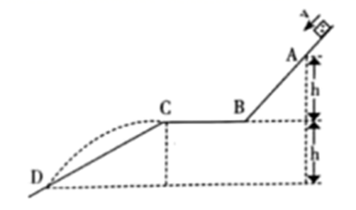

# Physics - 题目 1021

**ID**: 7af04fcd1c9045d18a26cddf503d1b69
**年级**: Grade 8
**难度**: Medium-Hard
**题型**: Multiple-choice

## 题目
如图所示，木块以一定的速度滑过AB点，到C点滑出下落至D点。​​​​​​​‌A和B，C和D之间的垂直距离均为h，则木块在运动过程中能量变化的分析，正确的是（      ）

## 解答

1. A．D点的机械能比C点的少，因为从C到D有部分的机械能克服空气阻力做功，转化为内能，故A不正确；
2. B．木块以一定的速度滑过AB点，而从A到B的过程，木块的重力势能减小，减小的重力势能虽然转化为动能和内能，但若接触面足够粗糙，摩擦力足够大，那么木块可能在AB间做匀速直线运动或减速运动，所以B点的动能可能等于可小于A点的动能，故B不正确；
3. C．木块从B到C，若木块与接触面有摩擦，则C点的动能小于B点的动能，从C到D，木块的重力势能减小，动能增加，那么D点动能大于C点动能，所以D点的动能有可能等于B点的动能，故C正确；
4. D．因为A和B，C和D之间的垂直距离均为h，则从A到B和从C到D的重力势能的减少量都是mgh（设木块的质量为m），故D不正确。
5. 故选C。

## 知识点

**中文**:
  - 动能的变化问题
  - 重力势能的变化问题
  - 机械能的变化问题

**English**:
  - Changes in Kinetic Energy
  - Changes in Gravitational Potential Energy
  - Changes in Mechanical Energy

---
