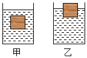

# Physics - 题目 1632

**ID**: 7b82d5c789364f5f925a100abac72fda
**年级**: Grade 8
**难度**: Medium-Hard
**题型**: Multiple-choice

## 题目
如图所示，放在同一水平桌面上的甲、乙两个相同的容器盛有不同的液体，现将两个完全相同的物块分别放入两容器中，当两物块静止时所处的位置如图，此时两容器中液面恰好相平。​​​​​​​‌下列说法正确的是（      ）①甲容器中液体对容器底部的压强较大②甲、乙两容器底部受到液体的压力相等③甲、乙两容器中物块排开液体的重力相等④乙容器中液体对容器底部的压力较大

## 解答

1. ①②④由图可知，物块在甲容器悬浮，则
2. ρ_{甲}＝ρ_{物}
3. 物块在乙容器的漂浮，则
4. ρ_{乙}＞ρ_{物}
5. 故两种液体的密度关系为
6. ρ_{甲}＜ρ_{乙}
7. 两容器液面等高，根据p＝ρgh可知，两种液体对容器底压强关系为
8. p_{甲}＜p_{乙}
9. 容器的底面积相同，根据F＝pS可知，乙容器中液体对容器底部的压力较大，故①②错误，④正确；
10. ③两个相同的物块，在甲容器的物块悬浮，在乙容器的物块漂浮，则两个相同的物块受到的浮力关系为
11. F_{甲}＝F_{乙}＝G
12. 根据阿基米德原理可知
13. G_{甲排}＝G_{乙排}
14. 故③正确；
15. 故选：C。

## 知识点

**中文**:
  - 压力大小的比较
  - 液体压强的大小及其计算
  - 阿基米德原理的应用
  - 物体的浮沉条件及其应用

**English**:
  - Comparing Magnitude of Pressure Force
  - Magnitude and Calculation of Liquid Pressure
  - Applications of Archimedes' Principle
  - Floating/Sinking Conditions and Applications

---
