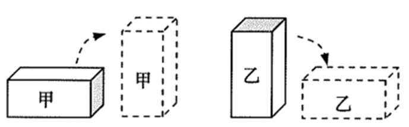

# Physics - 题目 1993

**ID**: 8770d6bf4f9042fc87effae48201d384
**年级**: Grade 8
**难度**: Medium-Hard
**题型**: Multiple-choice

## 题目
如图所示，体积相同的长方体甲、乙置于水平地面，其中甲、乙阴影部分为等大的正方形，甲、乙的密度分别为 $ρ{{}_{甲}}$ 、 $ρ{{}_{乙}}$ ，对地面的压强分别为p_{甲}、p_{乙}，将它们顺时针旋转90°，甲、乙对地面压强的变化量分别为 $\Delta p{{}_{甲}}$ 、 $Δp{{}_{乙}}$ ｡若 $Δp{{}_{甲}}<Δp{{}_{乙}}$ ，则（      ）​​​​​​​‌

## 解答

1. 由题意知，甲、乙的体积相同，在水平地面上的压力等于重力，则甲对地面的压强变化量为
2. $Δp{{}_{甲}}{\rm{=}}\frac {F{{}_{甲}}}{S{{}_{立}}}{\rm{-}}\frac {F{{}_{甲}}}{S{{}_{平}}}{\rm{=}}\frac {G{{}_{甲}}}{S{{}_{立}}}{\rm{-}}\frac {G{{}_{甲}}}{S{{}_{平}}}$
3. 乙对地面的压强变化量为
4. $Δp{{}_{乙}}{\rm{=}}\frac {F{{}_{乙}}}{S{{}_{立}}}{\rm{-}}\frac {F{{}_{乙}}}{S{{}_{平}}}{\rm{=}}\frac {G{{}_{乙}}}{S{{}_{立}}}{\rm{-}}\frac {G{{}_{乙}}}{S{{}_{平}}}$
5. 由 $Δp{{}_{甲}}<Δp{{}_{乙}}$ ，可知
6. $(\frac {G{{}_{甲}}}{S{{}_{立}}}{\rm{-}}\frac {G{{}_{甲}}}{S{{}_{平}}})<(\frac {G{{}_{乙}}}{S{{}_{立}}}{\rm{-}}\frac {G{{}_{乙}}}{S{{}_{平}}})$
7. 根据公式
8. G=mg=ρVg
9. 求得 $G{{}_{甲}}<G{{}_{乙}}$ ， $ρ{{}_{甲}}<ρ{{}_{乙}}$ 。
10. 将它们顺时针旋转90°，此时甲对地面的压强为
11. $p{{}_{甲}}{\rm{=}}\frac {F{{}_{甲}}}{S{{}_{立}}}{\rm{=}}\frac {G{{}_{甲}}}{S{{}_{立}}}$
12. 乙对地面的压强为
13. $p{{}_{乙}}{\rm{=}}\frac {F{{}_{乙}}}{S{{}_{平}}}{\rm{=}}\frac {G{{}_{乙}}}{S{{}_{平}}}$
14. 由 $G{{}_{甲}}<G{{}_{乙}}$ 和 $S{{}_{立}}<S{{}_{平}}$ 可知， $p{{}_{甲}}＜p{{}_{乙}}$ ，故ACD不符合题意，B符合题意。
15. 故选B。

## 知识点

**中文**:
  - 压强大小的比较
  - 固体压强的判断与计算

**English**:
  - Comparing Pressure
  - Determination and Calculation of Solid Pressure

---
