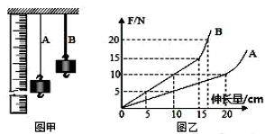

# Physics - 题目 2626

**ID**: acb808a69fff4b1eb41f1b208b925b86
**年级**: Grade 8
**难度**: Medium-Hard
**题型**: Multiple-choice

## 题目
某实验小组的同学对A、B两根橡皮筋进行探究，将橡皮筋的一端固定，另一端悬挂钩码图甲所示，记录橡皮筋受到的拉力大小F和橡皮筋伸长量，根据多组测量数据做出的图线如图乙所示。​​​​​​​‌下列说法正确的是（      ）

## 解答

1. A．由图乙可知，在测量范围内，如拉力为5N时，用橡皮筋A制成的测力计伸长10cm，而用橡皮筋B制成的测力计伸长5cm，所以，用橡皮筋A制成的测力测量的精确程度高，故A错误；
2. BC．A最大受到10N的拉力，在弹性范围内最多伸长20cm，B在弹性范围内，受到的最大拉力为15N，最多伸长15cm，将本实验中两根相同的橡皮筋并联起来使用时，故A只能伸长15cm，根据在测量范围内受到拉力与伸长成正比，故A最多受到的拉力
3. F_{A}_{大}= $\frac {15{\rm{c}}{\rm{m}}}{20{\rm{c}}{\rm{m}}}$ ×10N=7.5N
4. 将本实验中相同的两根橡皮筋并联起来代替弹簧秤能够测量力的最大值应为
5. 7.5N+15N=22.5N
6. 将本实验中两根橡皮筋串接起来一起用，由两根橡皮筋受到的最大拉力可知，能够测的力最大值为10N，故B错误，C正确；
7. D．A橡皮筋在受到的接力不大于10N的情况下，橡皮筋伸长量与橡皮筋受到的拉力大小变化关系为一直线，说明橡皮筋的伸长与受到拉力成正比，橡皮筋上悬挂重力为8N的物体时
8. $\frac {5{\rm{N}}}{10{\rm{c}}{\rm{m}}}{\rm{=}}\frac {8{\rm{N}}}{Δx}$
9. Δx=16cm
10. 故D错误。
11. 故选C。

## 知识点

**中文**:
  - 双弹簧测力计问题
  - 探究弹簧测力计原理的实验

**English**:
  - Problems involving Two Spring Dynamometers
  - Experiment: Principle of Spring Dynamometer

---
