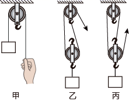

# Physics - 题目 2807

**ID**: c1134898dbac4ba3a0055fb14b9e909e
**年级**: Grade 8
**难度**: Medium-Hard
**题型**: Multiple-choice

## 题目
如图所示，用甲、乙、丙三种方式匀速提升相同物体，物体上升速度相同。​​​​​​​‌已知每个滑轮组均相同，不计绳重和摩擦力。则下列说法正确的是（      ）

## 解答

1. 由图可知，甲方式
2. F_{甲}=G_{物}
3. 乙方式
4. F_{乙}= $\frac {1}{2}$ (G_{物}+G_{动})
5. 丙方式
6. F_{丙}= $\frac {1}{3}$ (G_{物}+G_{动})
7. 故F_{甲}>F_{乙}>F_{丙}。
8. A．甲方式只对物体做功，乙装置和丙装置同时对物体和滑轮做功，则甲方式最省功，故A错误；
9. B．因为物体提升速度相同，由P=Fv可知，甲方式的功率
10. P_{甲}=F_{甲}v_{甲}=G_{物}v
11. 乙方式的功率
12. P_{乙}=F_{乙}v_{乙}=$\frac {1}{2}$ (G_{物}+G_{动})×2v_{物}=(G_{物}+G_{动})v_{物}
13. 丙方式的功率
14. P_{丙}=F_{丙}v_{丙}=$\frac {1}{3}$ (G_{物}+G_{动})×3v_{物}=(G_{物}+G_{动})v_{物}
15. 故乙方式的功率与丙方式的功率相等，故B错误；
16. C．甲方式拉物体时，没有额外功产生，此时有用功等于总功；乙和丙两种方式拉物体时，都有对动滑轮做的额外功，此时有用功小于总功；故甲方式机械效率最高，故C正确；
17. D．由W=Fs可得，没有提供移动的距离，无法得到做功的多少，故无法比较，故D错误。
18. 故选C。

## 知识点

**中文**:
  - 功率大小的比较
  - 功的大小比较
  - 定滑轮及其工作特点
  - 滑轮组及其工作特点
  - 滑轮（组）的机械效率及其计算

**English**:
  - Comparing Magnitude of Power
  - Comparing Magnitude of Work
  - Fixed Pulleys and Operating Characteristics
  - Pulley Systems and Operating Characteristics
  - Mechanical Efficiency of Pulleys and Calculations

---
