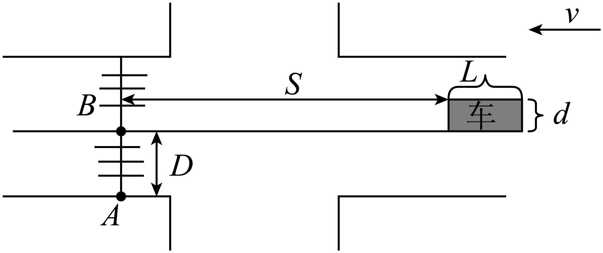

# Physics - 题目 989

**ID**: ccef12ab30854fdf887b5097a8ddcf43
**年级**: Grade 8
**难度**: Medium-Hard
**题型**: Multiple-choice

## 题目
交通安全人人有责，在如图所示的十字路口处，有一辆长L、宽d的客车，客车以恒定的速度v匀速行驶在马路中间（客车后无来车），当它与斑马线的中点B相距为s时，马路上的小王同学在没观察车的情况下，正好在斑马线的A点出发沿AB穿过马路，A、B间的距离为D，下列说法错误的是（      ）​​​​​​​‌

## 解答

1. A．客车行驶到斑马线中点B运动的路程是s，花的时间为
2. $t{{}_{车}}=\frac {s}{v}$
3. 故A正确，不符合题意；
4. B．客车从到达B点到完全通过B点的路程是L，所用的时间为
5. $t^{′}{{{}_{车}}}=\frac {L}{v}$
6. 故B正确，不符合题意；
7. C．若车刚穿过时人再穿过，人到B点所用的时间等于客车完全通过B点所用的时间，人通过的路程等于D，则小王运动的速度应小于
8. $ν{{}_{1}}=\frac {D}{t}=\frac {D}{\frac {L+s}{v}}=\frac {Dv}{L+s}$
9. 故C错误，符合题意；
10. D．若人刚穿过时车再穿过，人通过的路程等于D加上车宽，客车到达B点所用时间为
11. $t{{}_{车}}=\frac {s}{v}$
12. 小王运动的速度应大于
13. $v{{}_{2}}=\frac {s{{}_{2}}}{t{{}_{车}}}=\frac {D+d}{\frac {s}{v}}=\frac {(D+d)v}{s}$
14. 故D正确，不符合题意。
15. 故选C。

## 知识点

**中文**:
  - 速度公式及其应用

**English**:
  - Velocity Formula and Applications

---
