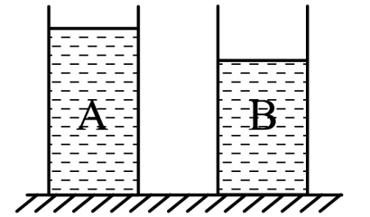

# Physics - 题目 1940

**ID**: d44815c4fe684472b7f613fb6a1d1e66
**年级**: Grade 8
**难度**: Medium-Hard
**题型**: Multiple-choice

## 题目
如图所示两个完全相同的圆柱形容器内分别盛有不同的液体A和B，已知A液体的质量小于B液体的质量．下列措施中，有可能使两容器内液体对容器底部的压强相等的是（无液体溢出）（      ）​​​​​​​‌

## 解答

1. 根据题意知道，两容器为圆柱形容器，对容器底的压力是：F=G=mg，由于m_{甲}＜m_{乙}，所以，甲液体对容器底的压力小于乙液体对容器底的压力，即F_{甲}＜F_{乙}，又因为底面积相同，由于 $p=\frac {F}{S}$ 知道， A液体对容器底的压强小于B液体对容器底的压强，即p_{甲}＜p_{乙}．
2. AC．若分别从A、B中倒入或抽出相同质量的液体，则A液体对容器底的压强增加量或减少量等于B液体对容器底的压强增加量或减小量，但不能使两容器内液体对容器底部的压强相等，故AC不可行；
3. B．若分别从A、B中倒入相同体积的液体，由于由于A的密度小于B的密度，故分别倒入相同体积的A、B两液体时，即倒入的A的质量较小，倒入的B液体的质量较大，故会使得A容器中的质量更小，B容器中的质量更大，所以，不可能实现两容器底部的压强相等，故B不可行；
4. D．分别从A、B中抽出相同体积的液体，由压力的增加量或减少量△F=△G=ρgV_{抽}和ρ_{A}＜ρ_{B}知道，△F_{A}＜△F_{B}，由 $p=\frac {F}{S}$ 和底面积S相同知道，会使A液体对容器底的压强增加量或减少量小于B液体对容器底的压强增加量或减少量，有可能使两容器内液体对容器底部的压强相等，故D可行．

## 知识点

**中文**:
  - 液体压强的判断与计算

**English**:
  - Determination and Calculation of Liquid Pressure

---
