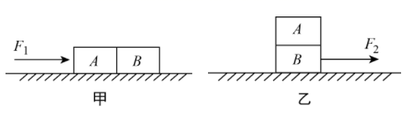

# Physics - 题目 1037

**ID**: e1b55ce560fa45919b3d29a41b9b2016
**年级**: Grade 8
**难度**: Medium-Hard
**题型**: Multiple-choice

## 题目
如图甲所示，完全相同的木块A和B叠放在水平桌面上，在12N的水平拉力F_{1}作用下，A、B一起作匀速直线运动，若将A、B紧靠着放在同一水平桌面上，用水平力F_{2}推A使它们一起匀速运动（如图乙所示），则推力F_{2}（      ）​​​​​​​‌

## 解答

1. A和B叠放在水平桌面上和A、B紧靠着放在同一水平桌面上，两种情况下A和B对水平桌面的压力大小都等于A和B的重力大小，重力不变，压力不变。两种情况下木块和水平桌面粗糙程度不变，滑动摩擦力不变。推动木块匀速直线运动，水平方向的推力和滑动摩擦力是平衡力，滑动摩擦力不变，推力不变，即
2. F_{2}=F_{1}=12N
3. 故选B。

## 知识点

**中文**:
  - 滑动摩擦力大小的影响因素
  - 滑动摩擦力的大小

**English**:
  - Factors Affecting Sliding Friction
  - Magnitude of Sliding Friction

---
