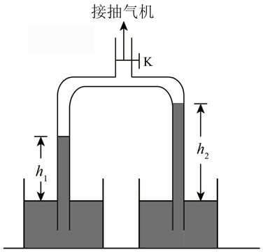

# Physics - 题目 2514

**ID**: f84ed0fbfff540749a9e64297d138b05
**年级**: Grade 8
**难度**: Medium-Hard
**题型**: Multiple-choice

## 题目
水平桌面上有两个装有液体的容器，左、右两边液体的密度分别为ρ_{1}、ρ_{2.}将一个带有阀门的三通U形管倒置在两个容器中，用抽气机将管内气体抽出一些，再关闭阀门K，液面静止时，左、右两边液面高度差分别为h_{1}、h_{2}，如图所示。​​​​​​​‌将U形管稍微上提一些后（管口还在液体中），下列说法不正确的是（      ）

## 解答

1. A．由平衡条件可得：左侧液柱
2. $p{{}_{0}}=ρ{{}_{1}}gh{{}_{1}}+p{{}_{气}}$
3. 右侧液柱
4. $p{{}_{0}}=ρ{{}_{2}}gh{{}_{2}}+p{{}_{气}}$
5. 由图知
6. $h{{}_{1}}<h{{}_{2}}$
7. 可得
8. $ρ{{}_{1}}>ρ{{}_{2}}$
9. 故A正确，A不符合题意；
10. B．管内气体质量、温度不变，体积变大，气体压强减小，故B正确，B不符合题意；
11. C．桌面受到的压强等于压力除以受力面积，在水平面上，压力等于容器的重力加上液体的重力，将U形管稍微上提一些后，容器中液体会进入管中，容器中液体重力减小，由于容器的重力和容器的液体的重力变小，即压力变小，所以压强变小，故C错误，C符合题意；
12. D．左侧液柱
13. $p{{}_{0}}=ρ{{}_{1}}gh{{}_{1}}+p{{}_{气}}$
14. 右侧液柱
15. $p{{}_{0}}=ρ{{}_{2}}gh{{}_{2}}+p{{}_{气}}$
16. 当p气减小，p_{0}不变，ρ_{1}gh_{1}变大，ρ_{2}gh_{2}变大， $ρ{{}_{1}}>ρ{{}_{2}}$ ，h_{1}、h_{2}都变大，且 $h{{}_{2}}>h{{}_{1}}$ ，故D正确，D不符合题意。
17. 故选C。

## 知识点

**中文**:
  - 大气压的应用
  - 液体压强的判断与计算

**English**:
  - Applications of Atmospheric Pressure
  - Determination and Calculation of Liquid Pressure

---
