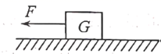

# Physics - 题目 2433

**ID**: feae6f04a0f240ffb17ad17fbe689903
**年级**: Grade 8
**难度**: Medium-Hard
**题型**: Multiple-choice

## 题目
如图所示，物体G静止在粗糙的水平地面上，用水平向左的拉力F去拉物体。​​​​​​​‌第一次F_{1}=10N，物体未被拉动；第二次F_{2}=15N，物体恰好能向左做匀速直线运动；第三次F_{3}=20N，物体向左运动。下列说法正确的是（      ）

## 解答

1. A．当F_{1}=10N时，物体未被拉动，在水平方向由二力平衡知拉力等于摩擦力即
2. f＝F＝10N
3. 故A错误；
4. B．用大小为15N的力水平向左拉物体，物体向左做匀速直线运动，物体发生了相对运动，此时属于滑动摩擦力，故
5. f＝F＝15N
6. 故B正确；
7. C．摩擦力方向与物体的相对运动方向或相对运动趋势方向相反，物块相对与地面是向左运动的，所以地面对物块的摩擦力方向向右，故C错误；
8. D．当拉力是20N，因为影响滑动摩擦力的因素是压力的大小和接触面的粗糙程度没有发生变化，因此当把拉力F增大为20N时，则物体受到的摩擦力仍为15N，故D错误。
9. 故选B。

## 知识点

**中文**:
  - 力的合成与应用
  - 滑动摩擦力大小的影响因素
  - 滑动摩擦力的方向

**English**:
  - Composition of Forces and Applications
  - Factors Affecting Sliding Friction
  - Direction of Sliding Friction

---
